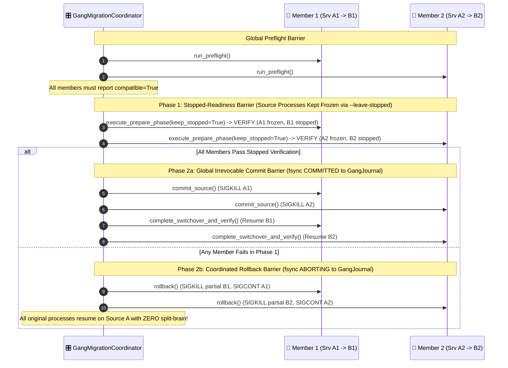

# LKMP (`lkmp`) — Linux Process Live Migration Orchestrator

<p align="center">
  <a href="https://github.com/xsub/LKMP/actions/workflows/ci.yml"></a>
  <a href="https://opensource.org/licenses/Apache-2.0"></a>
  <a href="https://www.python.org/downloads/"></a>
  <a href="https://criu.org/"></a>
  
</p>

**LKMP** (`lkmp`) is an enterprise-grade process-tree live migration orchestrator built on top of **CRIU** (*Checkpoint/Restore In Userspace*). It moves a running Linux process (or complex process tree) from **Source Host A** to **Destination Host B** with sub-second downtime, preserving virtual memory, CPU registers, open file descriptors, and established TCP connections—while enforcing a **Coordinated Two-Phase Cutover with Stopped-Readiness Barrier & WAL Roll-Forward** protocol with deterministic rollback and durable crash recovery.

<p align="center">
  
</p>

---

## Architectural Pillars & Hardened SOTA Capabilities

### 1. Coordinated Two-Phase Cutover with Stopped-Readiness Barrier & WAL Roll-Forward
- **Strict Phase Isolation (`lkmp/orchestrator.py`, `lkmp/gang.py`)**:
  - **Phase 1 (`execute_prepare_phase`)**: Executes preflight, incremental filesystem and memory pre-dumps, host freeze, final dump, transfer, pre-restore IP assignment, CRIU restore, and stopped readiness barrier (`verify_restored_stopped`, confirming both kernel `T`/`t` stopped state across every restored PID/thread via `/proc/<pid>/stat` and active `nftables` `input`/`output` `drop` rules via `nft list table`) up through `VERIFY` on Destination B. Throughout Phase 1, the source process tree on Host A remains frozen via `--leave-stopped` (`SIGSTOP` / `cgroup v2` freezer)—it is **never** terminated during Phase 1.
  - **Phase 2 (`commit` / `rollback`)**: Only after Destination B (or *all* members of a gang migration) successfully passes health verification does the coordinator issue an irrevocable `commit()`: `commit_source` first confirms `TCP_REPAIR = 1` across the source process tree (`set_tree_tcp_repair` with kernel `getsockopt(SOL_TCP, TCP_REPAIR)` read-back verification) before sending `SIGKILL`, unfreezes any source `cgroup v2` workload envelope (`unfreeze_cgroup`), and cryptographically zero-wipes checkpoint images. `commit_source` persists `"committed": True` to `source_state.json` strictly **after** `SIGKILL` succeeds across the source process tree, and `_signal_process_tree` propagates any non-`ESRCH` `OSError` (such as `EPERM`).
  - If any failure occurs in Phase 1 (restore failure, network timeout, failed `--health-cmd`, or image tamper), the coordinator executes a deterministic `rollback()`: `rollback_dest` confirms `TCP_REPAIR = 1` (`set_tree_tcp_repair` via `pidfd_open` + `pidfd_getfd` + `getsockopt` read-back), tears down any `lkmp<id>` tunnel device, and sends `SIGKILL` to any partial process on B without emitting spurious `FIN`/`RST` packets; if `TCP_REPAIR` confirmation fails (`TcpRepairError`), `rollback_dest` fails closed without sending `SIGKILL` so no unconfirmed `FIN`/`RST` can escape. Only when `rollback_dest` succeeds (`rolled_back_dest == True`) does `rollback_source` confirm `TCP_REPAIR = 0` on source sockets, tear down any `lkmp<id>` IPIP/IP6IP6 tunnel (`teardown_tunnel`), drop packet isolation rules, reclaim IP on A, and resume the original process tree on Host A in-place via `SIGCONT` with zero state loss. If Destination B cleanup or `TCP_REPAIR` confirmation fails, Source A remains frozen and network-fenced.
  - **Per-Migration & Same-PID Concurrency Guards (`lkmp/agent.py`)**: `AgentService` enforces per-`migration_id` re-entrant locks and an active source-PID guard (`_active_source_pids`) that rejects concurrent attempts to freeze an already-frozen source PID under a second migration until commit or rollback releases it.
- **Process-Tree-Wide Lifecycle & PID-Reuse Protection (`lkmp/preflight.py`, `lkmp/agent.py`)**:
  - Process-tree-wide management recursively walks `/proc/<pid>/task/*/children` and `/proc/*/stat` parent-PID mappings via `discover_process_tree_pids` to ensure *all* child workers, threads, and grandchildren are frozen, resumed, or terminated together without orphaned processes.
  - Before issuing any `SIGSTOP`, `SIGCONT`, or `SIGKILL`—and inside `verify_process`, `verify_restored_stopped`, and `claim_ip_and_resume`—`lkmp-agent` validates field 22 (`starttime`) from `/proc/<pid>/stat` (`read_proc_starttime`) against recorded `restore_state.json` and WAL `restored_starttime` metadata (`restore_state.json` is preserved across `wipe_images_on_commit` zero-wiping). If a process exited and the kernel recycled its PID to an unrelated program, LKMP refuses to treat the foreign PID as healthy or signal it.
- **Application Consistency Levels & Freezer Polling (`lkmp/config.py`, `lkmp/envelope.py`)**:
  - **Default Syscall-Boundary Crash Consistency**: The process tree is frozen via the `cgroup v2` freezer controller, actively polling `/sys/fs/cgroup/<workload>/cgroup.events` until `frozen 1` is observed before invoking CRIU dump.
  - **Application-Quiesced Consistency (`--quiesce-cmd` / `--resume-cmd`)**: For database engines and stateful network services, `--quiesce-cmd` executes prior to packet locking and cgroup freezing to allow the application to drain in-flight requests, flush memory buffers, and run `fsync`. If the migration commits or rolls back, `--resume-cmd` is invoked to resume background application timers and processing loops.
- **Write-Ahead Log (`.wal.jsonl`, `lkmp/journal.py`)**:
  - Every state transition and decision (`PREPARING`, `PREPARED_STOPPED`, `COMMITTED`, `ABORTING`, `ROLLED_BACK`) is recorded to an append-only JSONL log with per-entry canonical SHA-256 checksums and mandatory `os.fsync` barriers on both the `.wal.jsonl` descriptor and its parent directory descriptor before remote RPC dispatch (propagating any `OSError` on file or directory `fsync` without advancing journal state). `open_migration_journal` and `MigrationJournal` operate strictly fail-closed: they never fall back to volatile `/tmp` directories on `OSError`/`PermissionError`, enforce persistent backing-storage verification (`require_persistent=True`) **by default across every `journal_dir`** (rejecting `tmpfs`/`ramfs`/`devtmpfs`/`rootfs`), synchronize `_seq` from existing disk entries (`sync_from_disk_if_exists`) so repeated recoveries strictly continue monotonic `seq` numbering (`last_seq + 1`), truncate only **unterminated** EOF write fragments (`not has_newline`) via `os.ftruncate` before appending, and raise `WalCorruptionError` on any corrupted `\n`-terminated record (refusing unsafe automatic rollback if a previously fsynced `COMMITTED` record suffered media corruption).
  - If the migration controller crashes mid-flight, the state is deterministically recovered via:
    ```bash
    lkmp recover --journal /var/lib/lkmp/journals/<id>.wal.jsonl --source 10.0.1.10:9700 --dest 10.0.1.11:9700
    ```
    If the journal belongs to a 2PC gang (`gang_id`), `<gang_id>.gang.wal.jsonl` persists authoritative `member_ids` and `member_configs`; `recover_from_journal` and `lkmp recover --gang-journal` verify full gang membership and the presence of every expected `<member_id>.wal.jsonl` before acting, and consult `<gang_id>.gang.wal.jsonl` **first** so a crash between gang `COMMITTED` and member `COMMITTED` never triggers a conflicting member rollback. Before executing `commit_source` (`SIGKILL` on Source A), recovery verifies Destination B holds a live restored PID matching its recorded `starttime`.

### 2. Supervised CRIU Daemons & Complete Memory Page Movement
- **Non-Blocking RPC Orchestration & Cross-Restart Orphan Hygiene (`lkmp/criu_driver.py`, `lkmp/agent.py`)**:
  - `criu page-server` natively supports `--daemon --pidfile <path>`, detaching immediately so agent JSON-RPC handlers return without blocking worker threads or timing out RPC connections.
  - Because upstream CRIU does not support `--daemon` on `lazy-pages` or `dump --lazy-pages`, `lkmp-agent` supervises them as background processes via `subprocess.Popen` (`run_background_daemon`, closing parent log file descriptors immediately after spawn), tracking their PIDs in `.pid` files. Across `lkmp-agent` restarts, `stop_daemon` inspects `/proc/<pid>/cmdline` and `/proc/<pid>/comm` (`_is_verified_criu_pid`) to safely reap orphaned CRIU `page-server`/`lazy-pages` daemons while refusing to signal recycled non-CRIU PIDs.
- **Explicit Memory Transfer Semantics by Strategy**:
  - **`COLD`**: Memory pages (`pages-*.img`) are transferred alongside checkpoint metadata via `rsync` (`sync_checkpoint_images(..., include_pages=True)`).
  - **`PRE_COPY`**: Memory pages (`pages-*.img`) are streamed directly over the network via `criu page-server --daemon`. After streaming completes, Destination B measures actual received byte counts (`finalize_page_server_round`), computes the Merkle root of received page files, and binds `dest_pages_merkle_root` into `manifest.sig.json` for end-to-end attestation.
  - **`LAZY` / `HYBRID`**: Destination B launches supervised `criu lazy-pages` prior to invoking `criu restore --lazy-pages`. Concurrently, Source A executes supervised `criu dump --lazy-pages`, establishing a demand-paging daemon pair backed by kernel `userfaultfd`.

### 3. Pre-Restore IP Assignment & Per-Migration `nftables` Isolation
- **Pre-Restore Socket Binding (`lkmp/network.py`)**:
  - Destination B assigns the workload IP (`ip addr replace <ip>/32 dev <iface>`) **before** invoking `criu restore --tcp-established`. This guarantees that kernel `TCP_REPAIR` socket `bind()` operations succeed immediately during descriptor reconstitution without `EADDRNOTAVAIL` errors.
- **Isolated & Atomic Per-Migration Fencing**:
  - During the freeze window, Source A is fenced using an isolated, per-migration table: `lkmp_lock_<migration_id>_<ip>`, committing table creation, flush, `input`/`output` filter chains, and `ip daddr`/`ip saddr` `drop` rules in a **single atomic `nft` batch transaction**. Repeated `lock_network` invocations atomically replace the ruleset inside one kernel `nf_tables` transaction with zero packet-leak window between `flush table` and `drop` rule installation—and if a re-lock batch fails while an active `drop` lock is already protecting the workload (`verify_network_locked`), the existing lock is preserved rather than deleted.
- **Dual-Stack IPv4/IPv6 Packet Locking, IPIP / IP6IP6 Tunnel Forwarding & Custom BGP Templates (`--ip-mobility tunnel|garp|arp|bgp|cloud`)**:
  - Full dual-stack endpoint parsing (`parse_host_port` / `format_rsync_remote` across `10.0.0.2:9700`, `[::1]:9700`, and `[2001:db8::2]:9700`), IPv6 `AgentServer` / `AgentClient` sockets (`AF_INET6`), and bracketed `rsync` remotes (`[2001:db8::2]:/path/`).
  - Tunnel mode (`tunnel` / `ebpf`) establishes an on-demand `ipip` (IPv4) or `ip6ip6` (IPv6) tunnel device (`lkmp<id>`) on Source A forwarding in-flight packets to Destination B until network fabric convergence completes, idempotently replacing stale devices on retry and tearing down tunnels cleanly on rollback.
  - Announces the relocated IP via Gratuitous ARP (`garp` / `arp`), BGP `/32` or `/128` host routes (`bgp`, supporting custom FRR/BIRD/GoBGP templates via `--bgp-daemon-cmd`), or cloud VPC API webhooks (`cloud`).

### 4. Fail-Closed Mutual TLS (mTLS), Turnkey PKI (`lkmp tls-init`), Bounded RPC & Checkpoint Attestation
- **Mandatory Mutual TLS with Client Verification (`CERT_REQUIRED`, `lkmp/agent.py`, `lkmp/pki.py`)**:
  - `TlsConfig(enabled=True)` operates strictly fail-closed: `AgentServer` sets `ssl.CERT_REQUIRED` against the trusted CA bundle, requiring mutual authentication on every TCP JSON-RPC connection, while `AgentClient` caches verified `SSLContext` instances (keyed by certificate mtime) and retries transient read-only RPC resets safely.
  - `lkmp tls-init` (`generate_mtls_pki`) generates a Root CA (`ca.crt`, `ca.key`) and SAN-signed node certificates (`node.crt`, `node.key` with `0600` key permissions and `serverAuth, clientAuth` EKU) compatible with both `lkmp-agent` and `criu page-server --tls`. `deploy/Dockerfile.node` + `deploy/entrypoint.sh` auto-bootstrap shared cluster mTLS certificates out of the box on port `9700` (with `/metrics` & `/healthz` on port `9701`).
  - `_RpcRequestHandler` enforces bounded `16 MiB` JSON-RPC frame reads (`MAX_RPC_MESSAGE_BYTES`) and per-socket timeouts (`120s`) to prevent memory-exhaustion or hung-socket DoS.
- **Strict Path-Traversal Sanitization (`lkmp/journal.py`, `lkmp/agent.py`)**:
  - All RPC identifiers (`migration_id`, `round_name`, `workload_id`) are validated against strict alphanumeric regex patterns (`^[A-Za-z0-9][A-Za-z0-9._-]{0,63}$`) and verified with `Path.is_relative_to(work_dir)` to guarantee no path traversal (`../`) escapes the scratch workspace. Secure directory wiping (`secure_wipe_directory`) enforces parent boundary checks before overwriting files.
- **Cryptographic Merkle Attestation (`lkmp/attestation.py`)**:
  - Checkpoint integrity is validated before restore (`verify_attestation=True`). Source metadata `.img` files and Destination B's received memory pages (`dest_pages_merkle_root`) are signed with HMAC-SHA256 using operator-supplied or ephemeral per-migration keys (no static cluster secrets). Even a 1-bit corruption in `core-*.img` or `pages-*.img` aborts the restore and triggers rollback.

### 5. 4-State Portability Assessment & Non-Destructive Preflight (`lkmp portability`, `lkmp preflight`)
- **4-State Per-Domain Portability Report (`BLOCKED` / `PREPARE` / `UNKNOWN` / `VERIFIED`)**:
  - `lkmp portability` evaluates the **entire process tree** (walking `/proc/<pid>/task/*/children` and `/proc/*/stat` `ppid` for all child PIDs, not just the root PID) across five independent domains:
    1. **`memory_and_cpu`**: CPU ISA superset verification (`avx2`, `avx512f`, `xsave`, `sve`), active `TracerPid` across any child PID, and active vs. passive dirty-rate sampling (`--active-sample-ms`).
    2. **`files`**: ELF `.note.gnu.build-id` verification, deleted-open file descriptors, destination scratch-disk capacity verification (`work_dir_free_bytes < rss_bytes` `BLOCKER` for `COLD`/`PRE_COPY`), and writable mount synchronization (`PREPARE` until frozen volume snapshot / rsync is configured).
    3. **`network`**: Explicit socket FD inspection across all child processes (`PREPARE` requiring `--tcp-established` + pre-restore IP assignment + `nftables` lock).
    4. **`devices`**: `/dev/nvidia*`, `/dev/dri/renderD*`, `/dev/kfd` (`PREPARE` with `--enable-gpu`, `BLOCKED` without), and arbitrary host char/block devices (`BLOCKED`).
    5. **`external_resources`**: Cross-tree pipe topology analysis (pipes whose read+write ends are both held within the inspected process tree are classified `OK`; pipes with external endpoints are `PREPARE`), `anon_inode` inspection (`io_uring` -> `BLOCKED`, `eventpoll`/`timerfd`/`signalfd`/`eventfd` -> `OK`, unrecognized `anon_inode` -> `UNKNOWN`), and kernel feature checks (`criu check --extra` and `criu check --feature`).
  - Rather than outputting a misleading percentage score, LKMP reports `UNKNOWN` whenever static read-only inspection cannot prove safety, and reaches `VERIFIED` only when isolated `--check-only` and `--trial-restore` validation succeed.
- **Podman-Style Consistent Frozen Data Snapshot & Same-Host CoW Fast Path (`lkmp/fs_sync.py`, `lkmp/agent.py`, `lkmp/orchestrator.py`)**:
  - During `freeze_and_final_dump`, LKMP enforces strict Podman-style ordering: `quiesce_cmd` -> `nftables` packet lock -> `cgroup.freeze = 1` (polling `cgroup.events` until `frozen 1`) -> `criu dump --leave-stopped` -> `snapshot_writable_paths_while_frozen` (`--volume-snapshot-cmd` or CoW snapshot into `vol_snap` while the process tree is still frozen). Both `snapshot_writable_paths_while_frozen` and `final_delta_sync` operate strictly fail-closed (`FileNotFoundError`), refusing to fall back to live mutable paths when any configured `writable_path` or its `vol_snap` entry is missing, guaranteeing memory pages and transferred on-disk files correspond to the exact same point in time.
  - When Source A and Destination B genuinely share an underlying host/filesystem (`is_same_host_or_shared_storage`), proven via a per-migration cryptographic probe file (`.lkmp_storage_probe.json` written by Destination B during `prepare_migration` and verified on Source A's local VFS—never inferred from equal IP or loopback addresses alone), the production migration pipeline (`execute_prepare_phase` -> `transfer_final_state` -> `sync_checkpoint_images`) automatically invokes Copy-on-Write reflinks (`cow_clone_directory` via `cp --reflink=auto` / `cp -c`) instead of `rsync`.

### 6. Adaptive Strategy Auto-Pilot & Knee-of-Curve Convergence
- **Process-Tree VMA Locality Profiler (`--strategy auto`, `lkmp/pagemap.py`)**:
  - Scans `/proc/<pid>/pagemap` soft-dirty bits (bit 55) across writable VMAs (`[heap]`, `[stack]`, `mmap`) of the **entire multi-process tree** (root PID + all child/grandchild workers via `_discover_tree_pids_for_pagemap`) to measure aggregate dirty rates, classifies pages into `COLD`, `WARM`, and `HOT_THRASHING`, calculates Shannon byte entropy (`0` to `8` bits/byte) for compression estimation, and selects `cold`, `pre-copy`, or `hybrid`.
- **Asymptotic Convergence Predictor (`lkmp/convergence.py`)**:
  - Models page decay trajectory `D(t) = D_inf + A * r^t` across pre-dump rounds and tracks `observed_bandwidth_mbps`, stopping pre-copy at the mathematical knee-of-curve (`D_inf`) before thrashing pages waste link bandwidth.

---

## Live Migration Pipeline & Rollback Safety Net

<p align="center">
  
</p>

### End-to-End Sequence Diagram

```mermaid
sequenceDiagram
    autonumber
    participant CLI as 💻 lkmp Controller
    participant A as 🟢 Source Host A (lkmp-agent)
    participant B as 🔵 Dest Host B (lkmp-agent)
    participant NET as 🌐 Network Fabric (GARP/BGP)

    rect rgb(18, 45, 31)
    Note over CLI,B: PHASE 1–3: READ-ONLY PREFLIGHT & ITERATIVE PRE-COPY (App Running on A — 0 ms Downtime)
    CLI->>A: get_capabilities() & inspect_process(pid) (Non-destructive pagemap read)
    CLI->>B: get_capabilities() & stat_files(paths)
    Note over CLI: Verify CPU ISA, ELF build-ids & CRIU availability on A & B
    CLI->>A: pre_sync_fs() (Initial rsync baseline pass)
    loop Iterative Pre-Copy (Round 1..N until converged)
        CLI->>B: start_page_server(round=N) -> criu page-server --daemon --pidfile
        CLI->>A: run_pre_dump(round=N) -> criu pre-dump --track-mem --page-server
        A-->>B: Stream dirty RAM pages over mTLS (:27000)
        CLI->>B: finalize_page_server_round(round=N) -> Measure received bytes & page Merkle root
    end
    end

    rect rgb(60, 42, 15)
    Note over CLI,NET: PHASE 4–7: FREEZE, METADATA TRANSFER & RESTORE (Downtime Window Begins)
    CLI->>B: start_page_server(round=final) -> criu page-server --daemon --pidfile
    CLI->>A: freeze_and_final_dump()
    Note over A: nftables lock (lkmp_lock_<id>_<ip>) + cgroup freeze + criu dump --leave-stopped
    A-->>B: Stream final dirty pages to page-server
    CLI->>B: finalize_page_server_round(round=final) -> Compute dest_pages_merkle_root
    CLI->>A: transfer_final_state(dest_pages_merkle_root)
    Note over A: Attest manifest.sig.json (metadata + dest pages root) + rsync metadata .img
    CLI->>A: release_ip(workload_ip) (Setup IPIP hairpin tunnel dev lkmp<id>)
    CLI->>B: restore_process()
    Note over B: 1. Verify HMAC & Merkle attestation<br/>2. nftables lock on B (lkmp_lock_<id>_<ip>)<br/>3. ip addr replace <ip>/32 (BEFORE criu restore so TCP_REPAIR succeeds)<br/>4. criu restore --tcp-established --leave-stopped
    CLI->>B: verify_restored_stopped(restored_pid)
    Note over B: Confirm /proc/<pid>/stat 'T'/'t' across tree + active nft list table drop rules
    CLI->>B: claim_ip_and_resume(restored_pid)
    B->>NET: Broadcast Gratuitous ARP / BGP /32 route + SIGCONT to restored process
    end

    rect rgb(18, 38, 60)
    Note over CLI,B: PHASE 8: TWO-PHASE COMMIT BOUNDARY (Source A Remains Frozen & Alive!)
    CLI->>B: verify_process(restored_pid, --health-cmd)
    end

    alt Phase 2a: Verification Succeeds (Irrevocable Commit)
        rect rgb(18, 38, 60)
        Note over CLI: Phase 8 Verified -> WAL: Log COMMITTED
        CLI->>A: commit_source() (SIGKILL frozen source process + zero-wipe .img)
        CLI->>B: cleanup_dest() (Zero-wipe checkpoint .img)
        end
    else Phase 2b: Verification or Restore Fails (Deterministic Rollback)
        rect rgb(65, 22, 26)
        Note over CLI: Failure Detected -> WAL: Log ABORTING
        CLI->>B: rollback_dest() (SIGKILL partial restored process + remove IP)
        CLI->>A: rollback_source() (Drop nftables lock + re-claim IP + SIGCONT source process)
        Note over A: Source process resumes on Host A with ZERO data loss!
        Note over CLI: WAL: Log ROLLED_BACK
        end
    end
```



### State Machine Diagram

```mermaid
flowchart LR
    classDef init fill:#21262d,stroke:#8b949e,color:#e6edf3,stroke-width:1.5px
    classDef online fill:#122d1f,stroke:#3fb950,color:#e6edf3,stroke-width:2px
    classDef freeze fill:#3b260c,stroke:#d29922,color:#e6edf3,stroke-width:2px
    classDef commit fill:#12263c,stroke:#58a6ff,color:#e6edf3,stroke-width:2px
    classDef fail fill:#42161b,stroke:#f85149,color:#ff7b72,stroke-width:2px

    INIT(["INIT"]):::init --> PREFLIGHT["1. PREFLIGHT<br/>Read-only ISA & CRIU Check"]:::online
    PREFLIGHT -->|"Compatible"| PREPARE["2. PREPARE<br/>FS Sync & Agent Session"]:::online
    PREFLIGHT -.->|"Blocker Found"| ABORTED(["ABORTED"]):::fail

    PREPARE --> PRE_COPY["3. PRE_COPY (1..N)<br/>criu page-server --daemon"]:::online
    PRE_COPY -->|"Dirty set shrinking"| PRE_COPY
    PRE_COPY -->|"Converged / Cap"| FREEZE["4. FREEZE<br/>nftables lock + cgroup"]:::freeze

    FREEZE --> FINAL_DUMP["5. FINAL_DUMP<br/>criu dump --leave-stopped"]:::freeze
    FINAL_DUMP --> TRANSFER["6. TRANSFER<br/>Attestation & Metadata"]:::freeze
    TRANSFER --> RESTORE["7. RESTORE<br/>Pre-assign IP + criu restore"]:::freeze
    RESTORE --> SWITCHOVER["8. SWITCHOVER<br/>Announce IP + SIGCONT on B"]:::freeze

    SWITCHOVER --> VERIFY{"9. VERIFY<br/>Health Check on B<br/>(Source A Frozen)"}:::commit
    VERIFY -->|"Healthy (Commit Phase)"| COMMIT(["10. COMMIT<br/>SIGKILL A & Zero-Wipe"]):::commit

    RESTORE -.->|"Restore Error"| ROLLBACK(["ROLLBACK<br/>Kill B & Resume A (SIGCONT)"]):::fail
    SWITCHOVER -.->|"Network Error"| ROLLBACK
    VERIFY -.->|"Health Check Failed"| ROLLBACK
```



---

## Migration Strategies & Memory Movement Mechanics

| Strategy (`--strategy`) | Memory Transfer Mechanism | Downtime Profile | Best For |
| :--- | :--- | :--- | :--- |
| **`auto`** *(recommended)* | Profiles pagemap write rates; dynamically selects `cold`, `pre-copy`, or `hybrid` | Workload-optimal | Production workloads with variable or unknown memory dynamics |
| **`cold`** | `pages-*.img` copied via `rsync` (`include_pages=True`) alongside metadata | Proportional to RSS / network bandwidth | Small memory footprints (`<= 8 MiB`), batch jobs, non-critical workers |
| **`pre-copy`** | `pages-*.img` streamed via `criu page-server --daemon`; byte volume verified on B | Sub-second (`final_dirty / bw + restore`) | General stateful microservices, databases, caching layers |
| **`lazy`** | On-demand page fetching via supervised `criu lazy-pages` on B + supervised `criu dump --lazy-pages` on A | Near-instant switchover | Very large memory footprints where pre-copy cannot converge |
| **`hybrid`** | Iterative `pre-dump` passes, cutover, followed by `userfaultfd` demand paging for hot pages | Minimal freeze downtime | Write-intensive workloads (`>= 70%` link bandwidth saturation) |

### Page Transfer & Attestation Binding
1. **Cold Transfers**: Checkpoint metadata and memory images are synchronized consistently using `rsync -a --numeric-ids --compress`.
2. **Pre-Copy Transfers**: The destination agent spawns `criu page-server --daemon --pidfile <path> --images-dir <dir> --port 27000 --tls`. Source A streams dirty pages directly to the daemon socket. Upon completion of each round, `finalize_page_server_round` measures the received image sizes directly on Destination B and calculates a cryptographic Merkle root across all `pages-*.img` files (`dest_pages_merkle_root`). This destination digest is signed by Source A into `manifest.sig.json`, eliminating man-in-the-middle or truncated stream vulnerabilities.
3. **Lazy / Hybrid Transfers**: Destination B launches supervised `criu lazy-pages` before invoking `criu restore --lazy-pages`. Concurrently, Source A executes supervised `criu dump --lazy-pages` in the background, allowing `userfaultfd` page-fault requests across the network to be served without blocking RPC handlers.

### Pre-Copy Convergence Rules
Pre-copy iterative rounds stop and transition to `FREEZE` when **any** of the following criteria is satisfied:
- **Target Downtime Met**: Remaining dirty page transfer time fits within `--target-downtime-ms` (`dirty_bytes <= effective_bw * target_downtime`).
- **Knee-of-Curve Floor (`D_inf`)**: The asymptotic dirty-page decay model detects that the dirty working set has reached a non-converging plateau (`dirty_bytes <= 1.20 * D_inf`).
- **Diminishing Returns**: Dirty memory volume decreases by less than `10%` (`--min-shrink-ratio 0.10`) compared to the prior round.
- **Iteration Cap**: Pre-copy round count reaches `--max-iter` (default `8`).

---

## Coordinated Gang Migration & Durable Crash Recovery

### Coordinated Two-Phase Gang Migration with Stopped-Readiness Barrier
Coupled microservices or MPI ranks cannot be migrated independently without risking distributed state desynchronization. LKMP provides `GangMigrationCoordinator` (`lkmp/gang.py`) to execute coordinated multi-process gang migrations with strict readiness barriers:



#### Gang Migration Invariants
1. **Stopped-Readiness Barrier**: During Phase 1 (`execute_prepare_phase(keep_stopped_on_prepare=True)`), every member process restored on Destination B remains stopped (`--leave-stopped`) and network-fenced, with `verify_restored_stopped` explicitly confirming kernel stopped state (`T`/`t`) across all restored PIDs/threads and active `nftables` `input`/`output` `drop` rules (`nft list table`) before Phase 1 completes. Meanwhile, all corresponding source processes on Host A remain alive and frozen. No source process is terminated during Phase 1.
2. **Safe Coordinated Rollback**: If any member fails during Phase 1 (restore failure, network timeout, failed `--health-cmd`, or image tamper), the coordinator fsyncs `ABORTING` to `GangJournal` and rolls back all prepared members. It records `ROLLED_BACK` and reports `atomic_rollback_triggered=True` **strictly if and only if** every member confirms `rolled_back=True` (otherwise preserving `ABORTING` and keeping any unconfirmed member fenced).
3. **Irrevocable Commit Order & Gang-Authoritative WAL Roll-Forward**: Only when all members successfully verify in stopped state does the coordinator fsync `COMMITTED` to `GangJournal`. `<gang_id>.gang.wal.jsonl` persists authoritative `member_ids` and `member_configs` (refusing partial recovery if any member WAL is missing), and `MigrationOrchestrator.recover_from_journal` always consults `<gang_id>.gang.wal.jsonl` first so a crash before per-member `COMMITTED` propagation still rolls forward deterministically. Before killing any Source A process (`commit_source`), roll-forward recovery verifies Destination B holds a live restored PID matching its recorded `starttime`.

### Durable Crash Recovery with Write-Ahead Log (WAL)
Every phase transition is persisted to an append-only `.wal.jsonl` log using `os.fsync`:
```text
{"seq": 1, "migration_id": "mig-9a2c", "state": "PREFLIGHT", "commit_decision": "PREPARING"}
{"seq": 2, "migration_id": "mig-9a2c", "state": "PREPARE", "commit_decision": "PREPARING"}
...
{"seq": 8, "migration_id": "mig-9a2c", "state": "VERIFY", "commit_decision": "PREPARING", "restored_pid": 8484}
{"seq": 9, "migration_id": "mig-9a2c", "state": "COMMIT", "commit_decision": "COMMITTED", "restored_pid": 8484}
```

If the controller host crashes or loses power, the operator simply re-executes recovery:
```bash
lkmp recover \
  --journal /var/lib/lkmp/journals/mig-9a2c.wal.jsonl \
  --source 10.0.1.10:9700 \
  --dest 10.0.1.11:9700
```
- If `COMMITTED` was logged, recovery executes `commit()` to finalize cleanup on Source A.
- If the log ended prior to `COMMITTED` (e.g., during `RESTORE` or `VERIFY`), recovery deterministically issues `rollback()` to restore the original workload on Source A.

---

## Try It in 5 Seconds (`lkmp demo`)

LKMP provides a built-in multi-node cluster simulator running over loopback TCP JSON-RPC sockets so you can validate pre-copy convergence, fault injection, and rollback mechanics without multi-host physical infrastructure:

```bash
git clone https://github.com/xsub/LKMP.git
cd LKMP

# 1. Run live pre-copy migration demo with Prometheus telemetry
./bin/lkmp demo --strategy auto --rss-mb 256 --dirty-mbps 40 --prometheus
```

```text
┌──────────────────────────────────────────────────────────────────────────┐
│ LKMP LIVE MIGRATION EXECUTION SUMMARY                                    │
├──────────────────────────────┬───────────────────────────────────────────┤
│ Migration ID                 │ mig-c698365a                              │
│ Strategy                     │ pre-copy                                  │
│ Outcome                      │ COMMITTED ON DESTINATION B                │
│ Final FSM State              │ COMMIT                                    │
│ Restored PID on Host B       │ 8484                                      │
│ Freeze Window Downtime       │ 1.85 ms                                   │
│ Total Migration Duration     │ 139.68 ms                                 │
└──────────────────────────────┴───────────────────────────────────────────┘

Iterative Pre-Copy Convergence (Online Phase — 0 ms Downtime):
  Round 1: [████████████████████████]  115.2 MiB in    0.1 ms  (STREAMED)
  Round 2: [█████░░░░░░░░░░░░░░░░░░░]   24.0 MiB in    0.1 ms  (STREAMED)
  Round 3: [██░░░░░░░░░░░░░░░░░░░░░░]   10.0 MiB in    0.1 ms  (CONVERGED)
           └─ Dirty set (10485760 B) is within target downtime budget (25000000 B)

FSM Trajectory:
  INIT -> PREFLIGHT -> PREPARE -> PRE_COPY -> PRE_COPY -> PRE_COPY -> FREEZE -> FINAL_DUMP -> TRANSFER -> RESTORE -> SWITCHOVER -> VERIFY -> COMMIT
```

```bash
# 2. Test transactional rollback via health check fault or image tamper injection
./bin/lkmp demo --strategy pre-copy --inject-fault verify
./bin/lkmp demo --strategy cold --inject-fault corrupt-image

# 3. Execute comparative SOTA benchmark across workload profiles
./bin/lkmp benchmark
```

```text
┌──────────────────────────────┬──────────┬───────────┬──────────┬───────────┬────────────────────────────┐
│ Workload Scenario            │ RSS      │ WriteRate │ AutoMode │ FreezeWin │ Final Outcome              │
├──────────────────────────────┼──────────┼───────────┼──────────┼───────────┼────────────────────────────┤
│ 1. Edge Microservice         │ 6 MiB    │ 0 MiB/s   │ cold     │ 1.80 ms   │ COMMIT (PID 8484)          │
│ 2. Stateful Redis / DB       │ 512 MiB  │ 35 MiB/s  │ pre-copy │ 1.75 ms   │ COMMIT (PID 8484)          │
│ 3. Write-Heavy AI/Analytics  │ 1024 MiB │ 105 MiB/s │ hybrid   │ 1.90 ms   │ COMMIT (PID 8484)          │
│ 4. Tampered .img Attack      │ 256 MiB  │ 30 MiB/s  │ pre-copy │ 1.40 ms   │ ROLLBACK (Merkle Block)    │
└──────────────────────────────┴──────────┴───────────┴──────────┴───────────┴────────────────────────────┘
```

---

## Production Deployment & Operational Runbook

### 1. Bootstrap Cluster mTLS PKI & Launch `lkmp-agent`

Generate a shared Root CA and SAN-signed per-node certificates with `lkmp tls-init`, then start `lkmp-agent` on both physical Linux hosts (requires `root` or `CAP_CHECKPOINT_RESTORE` + `CAP_SYS_ADMIN` + `CAP_NET_ADMIN`):

```bash
# Generate Root CA + node-a / node-b mTLS certificates (0600 private keys)
./bin/lkmp tls-init \
  --out-dir /etc/lkmp/tls \
  --host 10.0.0.1 --host 10.0.0.2 \
  --node node-a --node node-b

# On Source Host A (10.0.0.1) — RPC on :9700, Prometheus /metrics & /healthz on :9701
sudo ./bin/lkmp agent \
  --host 0.0.0.0 \
  --port 9700 \
  --metrics-port 9701 \
  --tls-ca /etc/lkmp/tls/ca.crt \
  --tls-cert /etc/lkmp/tls/node-a.crt \
  --tls-key /etc/lkmp/tls/node-a.key

# On Destination Host B (10.0.0.2)
sudo ./bin/lkmp agent \
  --host 0.0.0.0 \
  --port 9700 \
  --metrics-port 9701 \
  --tls-ca /etc/lkmp/tls/ca.crt \
  --tls-cert /etc/lkmp/tls/node-b.crt \
  --tls-key /etc/lkmp/tls/node-b.key

# Check live node health & Prometheus telemetry
./bin/lkmp status --agent 10.0.0.1:9700 --prometheus \
  --tls-ca /etc/lkmp/tls/ca.crt --tls-cert /etc/lkmp/tls/node.crt --tls-key /etc/lkmp/tls/node.key
```

### 2. Launch Workload inside a Migration Envelope on Host A

```bash
sudo ./bin/lkmp run \
  --id srv-1 \
  --ip 10.0.0.99/24 \
  --iface eth0 \
  -- /usr/local/bin/my-stateful-server
```

### 3. Run Non-Destructive Preflight Check

```bash
./bin/lkmp preflight \
  --pid 4242 \
  --source 10.0.0.1:9700 \
  --dest 10.0.0.2:9700 \
  --strategy auto \
  --tls-ca /etc/lkmp/ca.pem \
  --tls-cert /etc/lkmp/client.pem \
  --tls-key /etc/lkmp/client.key
```

### 4. Execute Live Migration

```bash
./bin/lkmp migrate \
  --pid 4242 \
  --workload-id srv-1 \
  --source 10.0.0.1:9700 \
  --dest 10.0.0.2:9700 \
  --strategy auto \
  --fs-mode rsync \
  --writable-path /var/lib/my-stateful-server \
  --ip-mobility tunnel \
  --workload-ip 10.0.0.99/24 \
  --health-cmd "curl -sf http://10.0.0.99:8080/healthz" \
  --tls-ca /etc/lkmp/ca.pem \
  --tls-cert /etc/lkmp/client.pem \
  --tls-key /etc/lkmp/client.key
```

### 5. Coordinated 2PC Gang Migration, WAL Inspection & Crash Recovery

```bash
# Execute atomic 2PC gang migration across coupled workloads
./bin/lkmp gang-migrate \
  --gang-id redis-pair-01 \
  --member pid=4242,source=10.0.0.1:9700,dest=10.0.0.2:9700,strategy=pre-copy,workload_ip=10.0.0.91/24 \
  --member pid=4243,source=10.0.0.1:9700,dest=10.0.0.2:9700,strategy=pre-copy,workload_ip=10.0.0.92/24 \
  --tls-ca /etc/lkmp/tls/ca.crt \
  --tls-cert /etc/lkmp/tls/node.crt \
  --tls-key /etc/lkmp/tls/node.key

# Non-destructively audit WAL checksums, sequence numbers, and gang membership
./bin/lkmp wal-inspect /var/lib/lkmp/journals/redis-pair-01.gang.wal.jsonl

# Recover an interrupted single-process or gang migration (WAL replay)
./bin/lkmp recover \
  --gang-journal /var/lib/lkmp/journals/redis-pair-01.gang.wal.jsonl \
  --tls-ca /etc/lkmp/tls/ca.crt \
  --tls-cert /etc/lkmp/tls/node.crt \
  --tls-key /etc/lkmp/tls/node.key
```

### 6. Run 4-State Portability Assessment (`lkmp portability`)

```bash
# 1. Read-only 4-state per-domain portability inspection across the entire process tree
./bin/lkmp portability \
  --pid 4242 \
  --source 10.0.0.1:9700 \
  --dest 10.0.0.2:9700 \
  --tls-ca /etc/lkmp/ca.pem \
  --tls-cert /etc/lkmp/client.pem \
  --tls-key /etc/lkmp/client.key

# 2. Controlled CRIU --check-only & isolated trial-restore verification (to reach VERIFIED)
./bin/lkmp portability \
  --pid 4242 \
  --source 10.0.0.1:9700 \
  --dest 10.0.0.2:9700 \
  --active-sample-ms 150 \
  --check-only \
  --trial-restore \
  --tls-ca /etc/lkmp/ca.pem \
  --tls-cert /etc/lkmp/client.pem \
  --tls-key /etc/lkmp/client.key
```

### 7. Run 12-Scenario Stateful Multi-Process Acceptance Suite & Real Linux CRIU E2E

LKMP includes a comprehensive 12-scenario acceptance suite proving live migration invariants across `COLD`, `PRE_COPY`, and `LAZY` strategies, 2PC fault injection boundaries, Milestone Scenario 11 (active TCP + file writes surviving a forced controller restart via WAL recovery), and Scenario 12 (Same-Host Two-VM CoW reflink fast path):

```bash
# 1. Run complete 12-scenario acceptance matrix (auto-detects REAL_CRIU on Linux root, or force --backend REAL_CRIU)
sudo ./bin/lkmp acceptance --backend REAL_CRIU

# 2. Output machine-readable JSON telemetry for automated CI gating
sudo ./bin/lkmp acceptance --backend REAL_CRIU --json

# 3. Execute real Linux host CRIU 4.2.1 E2E verification test harness on host (exits non-zero on any failure)
sudo python3 scripts/linux_criu_e2e.py
```

---

## Testing & Verification Scope

To maintain rigorous transparency, the verification scope is divided into automated test assertions and real Linux CRIU kernel testbed runs:

### Proven in CI & Verified on Linux 7.0 + CRIU 4.2.1 (`115 unittest` Cases + `12/12 REAL_CRIU lkmp acceptance` + `4/4 REAL_CRIU E2E`)
- **Real Linux CRIU 4.2.1 E2E (`scripts/linux_criu_e2e.py`, Verified `4/4 PASS` on Linux `7.0.0-42-generic` x86_64 with CRIU `4.2.1 GitID: f192861`, strict non-zero exit gate)**:
  1. **CRIU CLI Flag Verification (`PASS`)**: Verifies `criu page-server --daemon --pidfile` immediate detachment, passive `/proc/net/tcp` port listening detection, and `--lazy-pages` flag compatibility.
  2. **Scenario A — `REAL_CRIU COLD` Dump & Detached Restore (`PASS`)**: Checkpoints a live multi-process workload (`pstree.img`, `3 core-*.img`, `3 pages-*.img`), terminates the source tree, restores via `criu restore --restore-detached --shell-job`, and verifies continuous `state.log` record advancement (`5 -> 13` records).
  3. **Scenario B — `REAL_CRIU PRE_COPY` Page-Server Streaming (`PASS`)**: Streams iterative `criu pre-dump --track-mem --page-server` and final `criu dump --prev-images-dir` rounds to background `criu page-server --daemon` instances, verifying `6 pages-*.img` files (`35,405,824` bytes).
  4. **Scenario C — `REAL_CRIU LAZY` Supervised `Popen` & Demand-Paging Restore (`PASS`)**: Supervises background `criu dump --lazy-pages` and `criu lazy-pages --page-server`, restores the workload inside an isolated destination PID/mount namespace via `criu restore --lazy-pages --restore-detached`, and verifies active post-restore execution (`12` `state.log` records).
- **12-Scenario Stateful Acceptance Matrix (`lkmp acceptance --backend REAL_CRIU`, `12/12 PASS` on Linux 7.0 + CRIU 4.2.1)**:
  - Under `--backend REAL_CRIU`, `AcceptanceClusterHarness` provisions an isolated 3-NetNS L2 virtual Ethernet bridge fabric (`RealNetnsL2Fabric`: `ns_fab` client + `br0`, `ns_a` Source Host A, and `ns_b` Destination Host B) per scenario. Source A is dumped in `ns_a` via `criu dump --leave-stopped --shell-job --tcp-established` (asserting `tcp-stream-*.img` creation and asserting Source A remains alive and stopped), and Destination B restores concurrently in `ns_b` via `unshare --pid --mount --fork ... criu restore --restore-detached --leave-stopped --shell-job --tcp-established` **without** terminating Source A prior to restore. On rollback, Destination B confirms `TCP_REPAIR = 1` and terminates the restored tree, while Source A confirms `TCP_REPAIR = 0` and resumes the **exact original kernel task** in-place via `SIGCONT` (verified via unchanged `/proc/<pid>/stat` `starttime`, never restored from a backup copy). (On non-Linux/unprivileged machines, `POSIX_PROCESS_CLONE` runs the same `AF_INET` TCP workload over user-space `dup()` simulation without invoking kernel `TCP_REPAIR`.)
  - Scenarios 1–10: `COLD`, `PRE_COPY`, and `LAZY` cutovers plus fault injection at `FINAL_DUMP`, `TRANSFER` (1-bit `core-*.img` tamper), `RESTORE`, `VERIFY`, controller crash after restore (`CRASH_AFTER_RESTORE`), and 2-member Gang stopped-readiness barrier abort (`GANG_MEMBER_2_FAIL`) & mid-commit roll-forward recovery (`GANG_MID_COMMIT_FAULT`).
  - **Scenario 11 (Milestone)**: Active `AF_INET` TCP request-response loop + `state.log` file writer surviving a **forced controller restart** mid-cutover via `recover_from_journal()`, measuring both `client_observed_blackout_ms` and `criu_restore_duration_ms` with zero lost/duplicated records and zero dual execution.
  - **Scenario 12**: Same-Host Two-VM CoW Snapshot Fast Path (`SAME_HOST_COW`) executing through `MigrationOrchestrator.execute()` and verifying production `transfer_final_state` invokes CoW reflink cloning (`cp --reflink=auto` / `cp -c`) without `rsync`.
- **4-State Portability Assessment (`lkmp portability`)**: Evaluates `BLOCKED` / `PREPARE` / `UNKNOWN` / `VERIFIED` across `memory_and_cpu`, `files`, `network`, `devices`, and `external_resources` for all child PIDs in the process tree.
- **Crash Recovery WAL (`<id>.wal.jsonl` & `<gang_id>.gang.wal.jsonl`)**: Enabled by default in `MigrationOrchestrator` and `lkmp migrate`, enforcing persistent backing-storage checks (`require_persistent=True`) across *all* `journal_dir` paths (rejecting `tmpfs`/`ramfs`), fail-closed file and parent-directory `os.fsync` barriers, and orphaned `restore_state.json` / `restored.pid` discovery so controller crashes between `restore_process` and WAL recording still deterministically terminate any target process on rollback.
- **2PC Stopped-Readiness & Network Lock Barrier (`verify_restored_stopped`)**: Confirms across every PID and thread in the restored process tree that the kernel state in `/proc/<pid>/stat` is stopped (`T`/`t`) and confirms via `nft list table inet <table>` that both `input` (`daddr <ip> drop`) and `output` (`saddr <ip> drop`) filter chains are active on Destination B before Phase 1 completes.
- **Fail-Closed mTLS & Path Traversal Defenses**: Mandatory `ca_cert` + `cert_file` + `key_file` with `ssl.CERT_REQUIRED` when `tls.enabled=True`, and strict `is_relative_to(work_dir)` path validation.

### Requires Dual-Host Physical Network Fabric (`CAP_SYS_ADMIN` + `CAP_NET_ADMIN` + CRIU >= 3.19)
- **Cross-Host Active TCP Connection Continuity**: Real-world validation of kernel `TCP_REPAIR` socket restoration across separate physical L2/L3 network interfaces with BGP/GARP/IPIP convergence.
- **Multi-Host 10G/40G `userfaultfd` Page Servicing**: Latency and throughput tail-latency benchmarks under heavy write loads over physical NICs.

---

## Project Structure

```text
.
├── .github/workflows/ci.yml      # GitHub Actions CI matrix (Python 3.10 - 3.13 + Linux CRIU E2E)
├── bin/lkmp                      # Executable CLI entrypoint
├── docs/assets/                  # High-resolution architecture & pipeline SVG diagrams
├── scripts/
│   ├── install_criu_on_linux.sh  # Automated CRIU 4.2.1 source builder & verifier for Linux 6.x/7.x
│   └── linux_criu_e2e.py         # Real Linux CRIU E2E verification and CLI flag compatibility suite
├── lkmp/
│   ├── __init__.py               # Public Python SDK exports & package version (0.2.0)
│   ├── py.typed                  # PEP 561 static typing marker
│   ├── config.py                 # MigrationConfig, EnvelopeConfig, strategy/mobility enums
│   ├── models.py                 # 10-state FSM states, 4-state PortabilityReport & telemetry models
│   ├── pki.py                    # Turnkey Root CA & SAN-signed mTLS X.509 generator (lkmp tls-init)
│   ├── journal.py                # Append-only fsynced JSONL WAL, recovery & read-only wal-inspect
│   ├── envelope.py               # Namespace unshare (pid, net, mnt, ipc, uts, time), bind mounts & cgroup v2
│   ├── pagemap.py                # Multi-process tree /proc/<pid>/pagemap soft-dirty profiler & entropy
│   ├── preflight.py              # Process-tree /proc inspector, 4-state portability & disk/ISA checker
│   ├── convergence.py            # Pre-copy convergence math, observed bandwidth & D_inf predictor
│   ├── attestation.py            # Cryptographic SHA-256 Merkle tree & HMAC checkpoint attestation
│   ├── gang.py                   # Stopped-readiness barrier 2PC gang coordinator & GangJournal recovery
│   ├── criu_driver.py            # Daemonized CRIU builder, cross-restart orphan reaper & GPU hooks
│   ├── network.py                # Atomic nftables lock & IPv4/IPv6 Tunnel/GARP/BGP/Cloud IP mobility
│   ├── fs_sync.py                # Frozen volume snapshot, Same-Host CoW reflink clone & IPv4/IPv6 rsync
│   ├── telemetry.py              # Thread-safe Prometheus OpenMetrics exporter & terminal TUI renderers
│   ├── demo.py                   # Two-node loopback TCP simulation harness & benchmark runner
│   ├── acceptance.py             # 12-scenario multi-process stateful live migration acceptance matrix
│   ├── agent.py                  # Dual-stack mTLS JSON-RPC daemon, concurrency guards & /metrics HTTP server
│   ├── orchestrator.py           # 10-state 2PC migration controller, portability & WAL recovery engine
│   └── cli.py                    # Unified CLI parser and 13 subcommand dispatchers
├── deploy/
│   ├── Dockerfile.node           # Hardened Ubuntu 24.04 node image (:9700 mTLS RPC, :9701 /metrics & /healthz)
│   ├── entrypoint.sh             # Lock-serialized shared mTLS PKI bootstrap for multi-node containers
│   └── docker-compose.test.yml   # Multi-node privileged test cluster with shared CA & L2 bridge
└── tests/                        # 115 unit, portability, mTLS/IPv6, WAL recovery & 12-scenario acceptance tests
```

---

## Two-Node Test Cluster (Docker Compose)

You can launch a local two-node cluster (`node-a` at `172.28.0.10:9700` and `node-b` at `172.28.0.11:9700`, with shared auto-bootstrapped mTLS PKI and `/healthz` + `/metrics` on `:9701`) configured with CRIU, `nftables`, and `iproute2`:

```bash
docker compose -f deploy/docker-compose.test.yml up -d --build
```

---

## CLI Reference

| Command | Description |
| :--- | :--- |
| `lkmp tls-init` | Generate a Root CA (`ca.crt`) and SAN-signed mTLS leaf certificates (`node.crt`, `node.key`) |
| `lkmp agent` | Start the dual-stack `lkmp-agent` JSON-RPC daemon (`--port 9700`, optional `--metrics-port 9701`) |
| `lkmp status` | Query live node health, capabilities, active migrations, and Prometheus telemetry from `lkmp-agent` |
| `lkmp run` | Launch a process tree inside isolated PID/net/mnt/ipc/uts/time namespaces, bind mounts, and `cgroup v2` |
| `lkmp preflight` | Execute non-destructive, strictly read-only compatibility and ISA superset checks |
| `lkmp portability` | Run 4-state (`BLOCKED` / `PREPARE` / `UNKNOWN` / `VERIFIED`) per-domain portability assessment across the full process tree |
| `lkmp migrate` | Run live migration under Coordinated Two-Phase Cutover with mandatory durable WAL (`.wal.jsonl`) |
| `lkmp gang-migrate` | Execute atomic 2-Phase Commit (2PC) gang migration across multiple coupled process trees |
| `lkmp wal-inspect` | Non-destructively verify SHA-256 checksums, monotonic sequences, and 2PC decisions in a WAL journal |
| `lkmp recover` | Recover an interrupted single-process (`.wal.jsonl`) or gang (`.gang.wal.jsonl`) migration |
| `lkmp acceptance` | Run the 12-scenario stateful multi-process live migration acceptance verification suite |
| `lkmp demo` | Run loopback TCP RPC live migration simulation with fault injection and Prometheus metrics |
| `lkmp benchmark` | Execute comparative SOTA benchmark suite across memory dirtying profiles |

---

## License

Licensed under the [Apache License 2.0](LICENSE).
