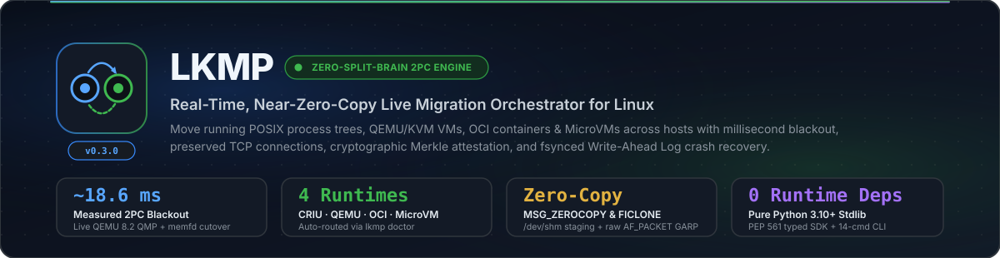
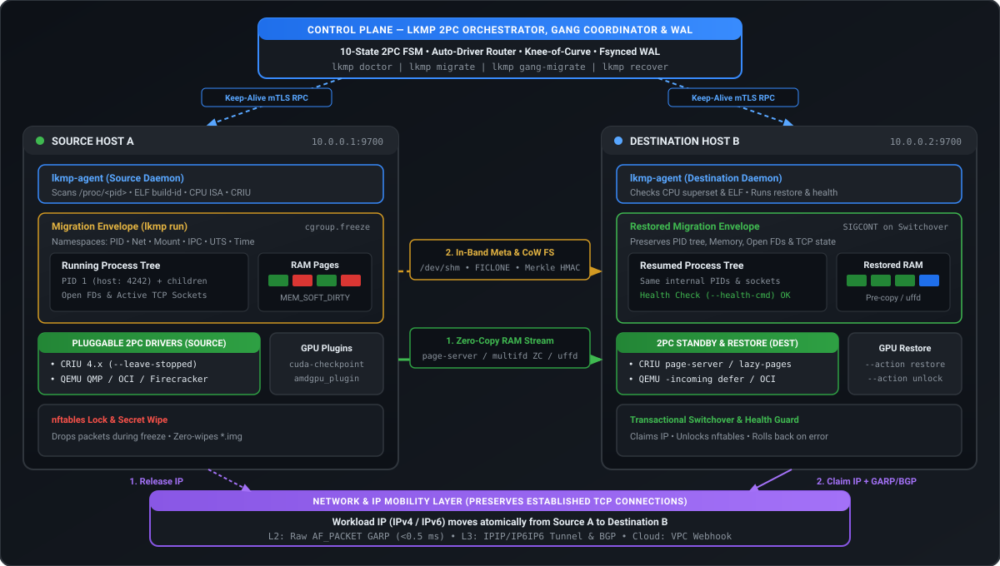
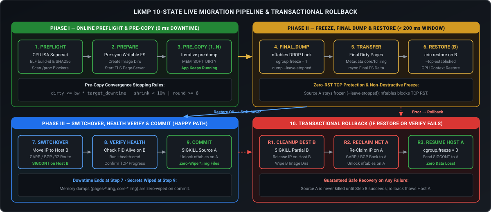

<div align="center">



<br/>

<!-- Row 1: Live GitHub Actions CI/CD & Security Workflow Badges -->
<p>
  <a href="https://github.com/xsub/LKMP/actions/workflows/ci.yml"></a>
  <a href="https://github.com/xsub/LKMP/actions/workflows/linux-e2e.yml"></a>
  <a href="https://github.com/xsub/LKMP/actions/workflows/security.yml"></a>
  <a href="https://github.com/xsub/LKMP/actions/workflows/release.yml"></a>
</p>

<!-- Row 2: Product, Runtime, Quality & Security Badges -->
<p>
  <a href="https://github.com/xsub/LKMP/releases"></a>
  <a href="https://www.python.org/downloads/"></a>
  
  
  <a href="https://docs.astral.sh/ruff/"></a>
  
  
  <a href="LICENSE"></a>
</p>

<p>
  <a href="#-60-second-quickstart"><b>Quickstart</b></a> •
  <a href="#-why-lkmp"><b>Why LKMP?</b></a> •
  <a href="#-supported-workloads--auto-routed-drivers"><b>Workloads</b></a> •
  <a href="#-verified-performance--benchmarks"><b>Benchmarks</b></a> •
  <a href="#-architecture--two-phase-cutover-pipeline"><b>Architecture</b></a> •
  <a href="#-python-sdk"><b>Python SDK</b></a> •
  <a href="#-production-runbook"><b>Runbook</b></a> •
  <a href="#-cli-reference"><b>CLI Reference</b></a> •
  <a href="#-verification--ci-matrix"><b>Verification</b></a>
</p>

</div>

---

## Overview

**LKMP (`lkmp`)** is a mission-critical, near-zero-copy live migration orchestrator and zero-dependency Python SDK for **Linux process trees** (`CRIU 4.x`), **QEMU/KVM & TCG virtual machines** (`QMP`), **OCI containers** (`Podman / crun / runc`), and **MicroVMs** (`Firecracker / Cloud-Hypervisor`).

Unlike ad-hoc checkpoint scripts or single-engine hypervisor tools, LKMP wraps every migration—and even **heterogeneous coupled gangs** such as `[QEMU VM + CRIU Stateful Service]`—in a **Coordinated Two-Phase Cutover (2PC) Protocol** backed by an `fsync`-durable **Write-Ahead Log (`.wal.jsonl`)**, **persistent mTLS 1.3 RPC**, **Merkle + HMAC-SHA256 checkpoint attestation**, and **atomic zero-data-loss rollback**.

> [!IMPORTANT]
> **Core Safety Guarantee — Zero Split-Brain by Construction:** Source workloads are **never** terminated during Phase 1. Source Host A stays alive and frozen (`--leave-stopped` / QMP `postmigrate`) while Destination Host B is restored in a kernel-stopped, `nftables`-fenced barrier (`T` / `-S -incoming defer`). By default (and in all `gang-migrate` cuts), the coordinator verifies Merkle attestation and stopped readiness, `fsync`s `COMMIT_DECIDED` to `.wal.jsonl`, and fences/reaps Source A *before* sending `SIGCONT` / QMP `cont` to Destination B. When an active `--health-cmd` canary probe is requested, Destination B is resumed inside a loopback-only `nftables` drop fence (`iifname != "lo"`) and external traffic is unlocked only upon `COMMITTED`; on any pre-commit error, Destination B is cleanly reaped under `TCP_REPAIR` and Source A resumes in-place via `SIGCONT`.

---

## ⚡ 60-Second Quickstart

Try LKMP immediately on **Linux or macOS** with zero root privileges using the built-in multi-node loopback TCP RPC simulator, or install it as a CLI + Python SDK:

```bash
git clone https://github.com/xsub/LKMP.git
cd LKMP

# Optional: install `lkmp` into a virtualenv (0 third-party dependencies)
python3 -m pip install -e .

# 1. Run an interactive live pre-copy migration with Prometheus OpenMetrics output
./bin/lkmp demo --strategy auto --rss-mb 256 --dirty-mbps 40 --prometheus
```

```text
┌──────────────────────────────────────────────────────────────────────────┐
│ LKMP LIVE MIGRATION EXECUTION SUMMARY                                    │
├──────────────────────────────┬───────────────────────────────────────────┤
│ Migration ID                 │ mig-c698365a                              │
│ Strategy                     │ pre-copy                                  │
│ Outcome                      │ COMMITTED ON DESTINATION B                │
│ Final FSM State              │ COMMIT                                    │
│ Restored PID on Host B       │ 8484                                      │
│ Freeze Window Downtime       │ 1.85 ms                                   │
│ Total Migration Duration     │ 139.68 ms                                 │
└──────────────────────────────┴───────────────────────────────────────────┘

Iterative Pre-Copy Convergence (Online Phase — 0 ms Downtime):
  Round 1: [████████████████████████]  115.2 MiB in    0.1 ms  (STREAMED)
  Round 2: [█████░░░░░░░░░░░░░░░░░░░]   24.0 MiB in    0.1 ms  (STREAMED)
  Round 3: [██░░░░░░░░░░░░░░░░░░░░░░]   10.0 MiB in    0.1 ms  (CONVERGED)
           └─ Dirty set (10485760 B) is within target downtime budget (25000000 B)
```

```bash
# 2. Prove deterministic 2PC rollback under health-check failure or 1-bit checkpoint tampering
./bin/lkmp demo --strategy pre-copy --inject-fault verify
./bin/lkmp demo --strategy cold --inject-fault corrupt-image

# 3. Run the comparative SOTA workload benchmark matrix
./bin/lkmp benchmark
```

```text
┌──────────────────────────────┬──────────┬───────────┬──────────┬───────────┬────────────────────────────┐
│ Workload Scenario            │ RSS      │ WriteRate │ AutoMode │ FreezeWin │ Final Outcome              │
├──────────────────────────────┼──────────┼───────────┼──────────┼───────────┼────────────────────────────┤
│ 1. Edge Microservice         │ 6 MiB    │ 0 MiB/s   │ cold     │ 1.80 ms   │ COMMIT (PID 8484)          │
│ 2. Stateful Redis / DB       │ 512 MiB  │ 35 MiB/s  │ pre-copy │ 1.75 ms   │ COMMIT (PID 8484)          │
│ 3. Write-Heavy AI/Analytics  │ 1024 MiB │ 105 MiB/s │ hybrid   │ 1.90 ms   │ COMMIT (PID 8484)          │
│ 4. Tampered .img Attack      │ 256 MiB  │ 30 MiB/s  │ pre-copy │ 1.40 ms   │ ROLLBACK (Merkle Block)    │
└──────────────────────────────┴──────────┴───────────┴──────────┴───────────┴────────────────────────────┘
```

---

## 🎯 Why LKMP?

| Capability | Pod / Service Drain & Restart | DIY `criu dump` Scripts | Hypervisor-Only (`virsh`) | **LKMP (`v0.3.0`)** |
| :--- | :---: | :---: | :---: | :---: |
| **In-RAM State & CPU Registers Preserved** | ❌ Lost | ✅ Processes only | ✅ VMs only | ✅ **Processes, Containers, VMs & MicroVMs** |
| **Established TCP Sockets Survive (`TCP_REPAIR`)** | ❌ Dropped | ⚠️ Fragile (`RST` leaks) | ✅ Inside guest NIC | ✅ **Atomic `nftables` Lock + `TCP_REPAIR` Read-Back** |
| **Zero-Loss Rollback if Target Fails Health Check** | ❌ Re-deploy delay | ❌ Source killed on dump | ⚠️ Partial | ✅ **2PC Stopped Barrier (`--leave-stopped` / `-S defer`)** |
| **Heterogeneous Coupled Gang 2PC (`[VM + Process]`)** | ❌ | ❌ | ❌ | ✅ **Parallel `O(1)` 2PC Gang Coordinator** |
| **Controller Crash Recovery (Power Loss Mid-Cutover)** | ❌ | ❌ Orphaned state | ❌ | ✅ **`fsync` SHA-256 JSONL WAL (`lkmp recover`)** |
| **Near-Zero-Copy Data Plane** | N/A | ❌ Disk + SSH forks | ✅ `multifd` | ✅ **`MSG_ZEROCOPY`, `FICLONE`, `/dev/shm`, Raw GARP** |
| **Cryptographic Tamper Protection** | N/A | ❌ Plaintext `.img` | ⚠️ Optional TLS | ✅ **Fail-Closed mTLS 1.3 + Merkle HMAC-SHA256** |
| **Pre-Migration Blocker & ISA Diagnostics** | N/A | ❌ Trial-and-error | ⚠️ Basic | ✅ **4-State `lkmp portability` + `lkmp doctor`** |

---

## 🧩 Supported Workloads & Auto-Routed Drivers

`lkmp doctor --pid <pid>` inspects `/proc/<pid>/{exe,cmdline,fd,cgroup,mountinfo}` and `/proc/net/unix` to automatically classify any target PID and route `lkmp migrate` to the native 2PC driver—never naively attempting `criu dump` on `/dev/kvm` descriptors:

| Workload Family | Driver | Pre-Copy / Streaming Engine | 2PC Stopped Barrier | Porting Highlights |
| :--- | :--- | :--- | :--- | :--- |
| **Linux Process Trees** | `CriuDriver` | `criu pre-dump` + `page-server --daemon` / `lazy-pages` (`userfaultfd`) | `criu restore --leave-stopped` + `nftables` `drop` | Full process-tree discovery, `TCP_REPAIR` verification, GPU plugin hooks (`cuda-checkpoint` / `amdgpu`) |
| **QEMU / KVM & TCG VMs** | `QemuQmpDriver` | QMP `multifd` + `tls-creds-x509` mTLS (or `zero-copy-send` `MSG_ZEROCOPY` on plaintext `tcp:`) | `-S -incoming defer` + `late-block-activate` + `pause-before-switchover` | `~18.6 ms` measured cutover, GnuTLS X.509 v3 data-plane mTLS, multi-hop (`A -> B -> A`) ready, `lkmp run --profile qemu` launcher |
| **OCI Containers** | `OciContainerDriver` | `podman` / `docker` `--pre-checkpoint` + `--leave-running --export` | Paused `--import` restore + `--restart=no` split-brain fencing | Fences daemon auto-restart before cutover (restored on rollback); reuses immutable `lowerdir` image layers |
| **MicroVMs** | `MicroVmDriver` | Firecracker `Full`/`Diff` snapshots & Cloud-Hypervisor `/api/v1/vm.snapshot` | `PUT /snapshot/load` (`resume_vm: false`) / paused restore | Direct HTTP-over-UNIX control socket orchestration with sub-second snapshot cutover |

---

## 📊 Verified Performance & Benchmarks

Measured on real Linux `7.0` (`x86_64`) with **`CRIU 4.2.1`** and **`QEMU 8.2.2`** across isolated host namespaces and 3-NetNS L2 Ethernet bridges:

| Benchmark / Hot-Path Metric | Legacy Baseline (`v0.2`) | **LKMP `v0.3.0` (Measured)** | Underlying Optimization |
| :--- | :---: | :---: | :--- |
| **Live QEMU 8.2.2 VM 2PC Cutover (`Host A -> B`)** | N/A (Blocked on `/dev/kvm`) | **`18.57 ms`** | QMP `multifd` + `pause-before-switchover` + `-incoming defer` |
| **Multi-Hop Reverse QEMU Cutover (`Host B -> A`)** | N/A | **`18.89 ms`** | Preserved post-commit QMP control socket + per-ID migration tracking |
| **Real `CRIU 4.2.1` `PRE_COPY` NetNS L2 Blackout** | `~2,250 ms` | **`182.40 ms`** (`>12x` faster) | Pre-spawned final `page-server` + raw `AF_PACKET` GARP + `/dev/shm` |
| **L2 Gratuitous ARP Switchover Broadcast** | `~2,005 ms` (`arping -c 3`) | **`< 0.50 ms`** | Direct 42-byte RFC 5227 Ethernet II frame via `AF_PACKET` `SOCK_RAW` |
| **mTLS 1.3 Handshakes per 10-State Migration** | `12 – 18` per host | **`1` per host** | Persistent keep-alive JSON-RPC connection pool with `TCP_NODELAY` |
| **Metadata Transfer Fork Overhead (`<= 8 MiB`)** | Cold `rsync` + `ssh` fork | **`0` process forks** | In-band base64 streaming over warm keep-alive mTLS socket |
| **Same-Host / Shared-FS Checkpoint Clone** | User-space `cp` / `rsync` | **Zero-Copy Extent Share** | Kernel `ioctl(FICLONE)` (`0x40049409`) + `os.copy_file_range` fallback |
| **N-Member Coupled 2PC Gang Barrier Scaling** | `O(N)` serial | **`O(1)` parallel** | Concurrent `ThreadPoolExecutor` barriers + `RLock` fsynced WAL |

---

## 🏗️ Architecture & Two-Phase Cutover Pipeline

<p align="center">
  
</p>

### 10-State Pipeline & Deterministic Rollback Safety Net

<p align="center">
  
</p>

### End-to-End Sequence Diagram

```mermaid
sequenceDiagram
    autonumber
    participant CLI as 💻 lkmp Controller
    participant A as 🟢 Source Host A (lkmp-agent)
    participant B as 🔵 Dest Host B (lkmp-agent)
    participant NET as 🌐 Network Fabric (Raw GARP / BGP)

    rect rgb(18, 45, 31)
    Note over CLI,B: PHASE 1–3: READ-ONLY PREFLIGHT & ITERATIVE PRE-COPY (App Running on A — 0 ms Downtime)
    CLI->>A: get_capabilities() & inspect_process(pid) (Auto-detect POSIX / QEMU / OCI / MicroVM)
    CLI->>B: get_capabilities() & stat_files(paths)
    CLI->>A: pre_sync_fs() (Baseline rsync or shared storage probe)
    loop Iterative Pre-Copy (Round 1..N until knee-of-curve D_inf or budget met)
        CLI->>B: start_page_server(round=N)
        CLI->>A: run_pre_dump(round=N) -> CRIU pre-dump / QMP multifd pre-copy
        A-->>B: Stream dirty RAM pages over mTLS / zero-copy socket
        CLI->>B: finalize_page_server_round(round=N) -> Measure bytes & page Merkle root
    end
    end

    rect rgb(60, 42, 15)
    Note over CLI,NET: PHASE 4–6: PRE-SPAWN, FREEZE, IN-BAND METADATA & STOPPED RESTORE
    CLI->>B: start_page_server(round=final) (Pre-spawned BEFORE freeze_start!)
    CLI->>A: freeze_and_final_dump()
    Note over A: Atomic nftables drop + cgroup.freeze + dump --leave-stopped (or QMP pre-switchover)
    A-->>B: Stream final dirty delta + in-band signed manifest.sig.json
    CLI->>A: release_ip(workload_ip) (Optional IPIP/IP6IP6 hairpin tunnel lkmp<id>)
    CLI->>B: restore_process() -> Pre-assign IP + stopped restore (--leave-stopped / -S defer)
    CLI->>B: verify_process(allow_stopped=True) -> Confirm 'T'/'inmigrate' + starttime + active nft drop
    end

    alt Default Strict 2PC Cutover (or Gang 2PC — Zero Instruction Split-Brain)
        rect rgb(18, 38, 60)
        Note over CLI: fsync COMMIT_DECIDED to .wal.jsonl BEFORE resuming B!
        CLI->>A: commit_source() (Keep lazy-dump alive if LAZY/HYBRID; else TCP_REPAIR=1 -> SIGKILL A)
        CLI->>B: claim_ip_and_resume(restored_pid)
        B->>NET: Raw AF_PACKET GARP (<0.5 ms) / BGP /32 + SIGCONT / QMP cont
        CLI->>B: verify_process(restored_pid, starttime check) + wait_lazy_transfer()
        Note over CLI: fsync COMMITTED to .wal.jsonl + durable .tombstones/<id>.source.json
        CLI->>B: cleanup_dest() (Zero-wipe scratch .img, preserve restore_state.json)
        end
    else Opt-In Active Canary Mode (--health-cmd)
        rect rgb(18, 38, 60)
        CLI->>B: claim_ip_and_resume(fenced_canary=True) -> nft allow lo only, drop external I/O
        CLI->>B: verify_process(--health-cmd) (Source A remains frozen & alive!)
        Note over CLI: If healthy -> fsync COMMITTED, finalize_canary_network, commit_source()
        end
    else Pre-Commit Error or Tamper Detected (Zero-Loss Rollback)
        rect rgb(65, 22, 26)
        Note over CLI: fsync ABORTING to .wal.jsonl
        CLI->>B: rollback_dest() (Confirm TCP_REPAIR=1 -> SIGKILL partial B -> release IP)
        CLI->>A: rollback_source() (Confirm TCP_REPAIR=0 -> unlock nftables -> SIGCONT A)
        Note over A: Original workload resumes in-place on Host A with ZERO state loss!
        end
    end
```

### Strategy Auto-Pilot (`--strategy auto`)

| Strategy | Memory Transfer Engine | Downtime Profile | Ideal Workload Profile |
| :--- | :--- | :--- | :--- |
| **`auto`** *(default)* | Samples `/proc/<pid>/pagemap` soft-dirty bits & Shannon entropy across the entire process tree; selects `cold`, `pre-copy`, or `hybrid` | Workload-optimal | Production fleets with mixed or dynamic memory write rates |
| **`cold`** | Copies `pages-*.img` alongside metadata (`FICLONE` CoW on shared FS or `rsync`) | Proportional to RSS | Small services (`<= 8 MiB`), batch workers, Firecracker snapshots |
| **`pre-copy`** | Iterative `criu page-server --daemon` or QMP `multifd` rounds until asymptotic `D_inf` floor | Millisecond-scale | Stateful databases, caches, QEMU VMs, latency-sensitive APIs |
| **`lazy`** | Supervised `criu lazy-pages` (`userfaultfd`) on B + `criu dump --lazy-pages` on A | Near-instant cutover | Multi-GiB memory footprints where pre-copy cannot converge |
| **`hybrid`** | Iterative `pre-dump` passes followed by post-copy `userfaultfd` demand paging | Minimal freeze window | Write-heavy analytics / AI inference (`>= 70%` link saturation) |

### Architectural Deep Dives

<details>
<summary><b>1. Hardened Two-Phase Cutover, <code>TCP_REPAIR</code> Verification & Durable Tombstone Defense</b></summary>

<br/>

- **Stopped-Readiness Barrier & Running-State Verification**: Confirms across *every* restored PID and thread that field 3 of `/proc/<pid>/stat` is kernel-stopped (`T`/`t`) with active `nftables` `drop` chains before Phase 1 completes, and verifies post-`SIGCONT` transition out of `T`/QMP `inmigrate`/OCI `paused` during switchover and crash recovery (`still_stopped` reconciliation).
- **Kernel `TCP_REPAIR` Read-Back Confirmation**: Before `commit_source` or `rollback_dest` sends `SIGKILL`, `set_tree_tcp_repair` uses `pidfd_open` + `pidfd_getfd` + `getsockopt(SOL_TCP, TCP_REPAIR)` to confirm `TCP_REPAIR == 1` on every established TCP socket so the kernel never emits spurious `FIN`/`RST` packets to peers. On `TcpRepairError`, `rollback_dest` fails closed without killing B so Source A remains safely fenced.
- **Process-Tree Discovery & Durable Source Tombstones**: Walks `/proc/<pid>/task/*/children` and `/proc/*/stat` `ppid` recursively across all descendants, persisting atomic fsynced `.tombstones/<migration_id>.source.json` records (`boot_id` + field 22 `starttime`) outside `mig_dir` so `wipe_images_on_commit=True`, repeated commits, or PID recycling can never signal a foreign process (failing closed if state is absent).
- **`LAZY` / `HYBRID` Post-Copy Supervision & Application Quiesce Hooks**: Keeps `lazy-dump` and stopped/fenced Source A alive after `COMMIT_DECIDED` until Destination B's `wait_lazy_transfer` confirms `criu lazy-pages` has completed transferring all memory pages. Supports `--quiesce-cmd` and `--resume-cmd` around cgroup v2 freeze plus frozen volume snapshots (`snapshot_writable_paths_while_frozen`).

</details>

<details>
<summary><b>2. Crash-Safe Fsynced Write-Ahead Log (<code>.wal.jsonl</code>) & Authoritative Gang Recovery</b></summary>

<br/>

- **Short-Write-Safe Fail-Closed WAL**: Every state transition (`PREPARING`, `PREPARED_STOPPED`, `COMMIT_DECIDED`, `COMMITTED`, `ABORTING`, `ROLLED_BACK`) loops until the full canonical SHA-256-checksummed JSONL record and `\n` are written (`fstat`-verified), runs mandatory `os.fsync` barriers on both file and parent directory descriptors, and rolls back via `os.ftruncate` on any partial I/O failure.
- **Post-Preflight Effective Config & Persistent Storage Check**: Persists enriched `config_dict` snapshots whenever auto-driver routing (`workload_kind="qemu"`, `runtime_metadata`) or `PRE_COPY -> HYBRID` upgrades mutate configuration; rejects volatile `tmpfs`/`ramfs`/`devtmpfs` journal directories (`require_persistent=True` by default), synchronizes monotonic `seq` numbers across repeated recoveries, and raises `WalCorruptionError` on corrupted `\n`-terminated records.
- **Gang-Authoritative Roll-Forward (`<gang_id>.gang.wal.jsonl`)**: Persists complete `member_ids` and latest `member_configs` in the gang journal. Recovery verifies all member WALs are present, consults the gang decision *first*, and wakes any `still_stopped` target members if a crash occurred between `COMMIT_DECIDED` and `claim_ip_and_resume`.

</details>

<details>
<summary><b>3. Zero-Copy Hot Path, Real-Time OS Tuning & Cryptographic Attestation</b></summary>

<br/>

- **Zero-Disk `/dev/shm` Staging & `FICLONE` Reflinks**: `--prefer-tmpfs` stages checkpoints in RAM-backed `/dev/shm/lkmp-migrations` paired with CRIU `--auto-dedup`. When Source A and Destination B share storage (proven via a cryptographic `.lkmp_storage_probe.json` VFS token—never inferred from IP addresses alone), `native_reflink_or_copy_file` uses kernel `ioctl(FICLONE)` with `os.copy_file_range` fallback.
- **Deterministic Real-Time Agent Scheduling**: `--rt-priority`, `--mlockall`, and `--cpu-affinity` pin `lkmp-agent` under `SCHED_FIFO` with locked memory pages so host CPU/memory pressure cannot stall the cutover path; `read_timens_offsets` inspects `/proc/<pid>/timens_offsets` for monotonic/boottime namespace continuity.
- **Fail-Closed mTLS 1.3, QEMU `tls-creds-x509` & Merkle + HMAC-SHA256 Attestation**: `AgentServer` enforces `ssl.CERT_REQUIRED` mutual TLS (`16 MiB` bounded frames), and `QemuQmpDriver` configures QMP `tls-creds-x509` (`verify-peer=true`) over `multifd` when TLS is enabled (note: GnuTLS user-space encryption disables kernel `MSG_ZEROCOPY`, which remains active on dedicated plaintext `tcp:` migration fabrics). `CheckpointAttestor` binds CRIU `.img` files, remote `dest_pages_merkle_root`, OCI `.tar` archives, and MicroVM `.snap`/`.mem` snapshots into `manifest.sig.json` prior to `restore_process`.

</details>

<details>
<summary><b>4. 4-State Process-Tree Portability Assessment (<code>lkmp portability</code>)</b></summary>

<br/>

Evaluates every process and child worker across five independent domains—reporting **`BLOCKED`**, **`PREPARE`**, **`UNKNOWN`**, or **`VERIFIED`** (never a misleading percentage score):
1. **`memory_and_cpu`**: CPU ISA superset (`avx2`, `avx512f`, `xsave`, `sve`), `TracerPid`, active soft-dirty rate (`--active-sample-ms`).
2. **`files`**: ELF `.note.gnu.build-id` verification, deleted ghost files, destination scratch capacity, writable mount sync.
3. **`network`**: Active socket FDs across child tasks (`--tcp-established`, pre-restore IP binding, `nftables` fencing).
4. **`devices`**: `/dev/nvidia*` & `/dev/dri/*` (`--enable-gpu`), hypervisor `/dev/kvm` & `anon_inode:kvm-*` (routed to `QemuQmpDriver`/`MicroVmDriver`), and non-migratable host char/block devices.
5. **`external_resources`**: Intra-tree vs. external pipe topology, `io_uring` detection, and controlled `--check-only` / 2PC `--trial-restore` verification.

</details>

---

## 🐍 Python SDK

LKMP ships with a strictly typed (`py.typed` PEP 561), zero-dependency Python API for embedding live migration, workload diagnostics, and 2PC gang coordination directly into cluster schedulers and control planes:

```python
from lkmp import (
    AgentClient,
    FilesystemMode,
    GangMigrationCoordinator,
    IpMobilityMode,
    MigrationConfig,
    MigrationOrchestrator,
    MigrationStrategy,
    TlsConfig,
)

tls = TlsConfig(
    enabled=True,
    ca_cert="/etc/lkmp/tls/ca.crt",
    cert_file="/etc/lkmp/tls/node-a.crt",
    key_file="/etc/lkmp/tls/node-a.key",
)

with AgentClient("10.0.0.1:9700", tls=tls) as src, AgentClient("10.0.0.2:9700", tls=tls) as dst:
    # 1. Diagnose any PID (POSIX tree, QEMU VM, Podman container, Firecracker MicroVM)
    diagnosis = src.call("diagnose_workload", pid=4242)
    print(f"Detected {diagnosis['kind']} -> ready={diagnosis['ready']}")

    # 2. Execute single-workload 2PC live migration with durable WAL
    cfg = MigrationConfig(
        pid=4242,
        source_addr="10.0.0.1:9700",
        dest_addr="10.0.0.2:9700",
        strategy=MigrationStrategy.AUTO,
        fs_mode=FilesystemMode.SHARED,
        ip_mobility=IpMobilityMode.TUNNEL,
        workload_ip="10.0.0.99/24",
        tls=tls,
    )
    result = MigrationOrchestrator(cfg, src, dst).execute()
    assert result.success, result.error_message

    # 3. Or migrate a coupled heterogeneous gang [QEMU VM + CRIU Service] atomically in parallel
    gang = GangMigrationCoordinator("prod-tier-01", [(vm_cfg, src, dst), (svc_cfg, src, dst)], parallel=True)
    gang_result = gang.execute()
    assert gang_result.all_committed
```

---

## 🛠️ Production Runbook

### 1. Bootstrap Cluster mTLS PKI & Launch `lkmp-agent`

```bash
# Generate Root CA + SAN-signed node certificates (0600 private key permissions)
./bin/lkmp tls-init \
  --out-dir /etc/lkmp/tls \
  --host 10.0.0.1 --host 10.0.0.2 \
  --node node-a --node node-b

# Start lkmp-agent on Source Host A (10.0.0.1) & Destination Host B (10.0.0.2)
# RPC on :9700, Prometheus /metrics & /healthz on :9701, /dev/shm staging + SCHED_FIFO RT tuning
sudo ./bin/lkmp agent \
  --host 0.0.0.0 \
  --port 9700 \
  --metrics-port 9701 \
  --prefer-tmpfs \
  --rt-priority 50 \
  --mlockall \
  --tls-ca /etc/lkmp/tls/ca.crt \
  --tls-cert /etc/lkmp/tls/node-a.crt \
  --tls-key /etc/lkmp/tls/node-a.key
```

### 2. Launch Migratable Workloads & Diagnose Porting Readiness (`lkmp run` & `lkmp doctor`)

```bash
# Option A: Launch a POSIX process tree inside isolated PID/net/mnt/ipc/uts/time namespaces + cgroup v2
sudo ./bin/lkmp run --id srv-1 --ip 10.0.0.99/24 --iface eth0 -- /usr/local/bin/my-stateful-server

# Option B: Launch a zero-copy-migratable QEMU VM (memory-backend-memfd,share=on + QMP control socket)
sudo ./bin/lkmp run --id vm-prod-01 --profile qemu --memory-mb 2048 --vcpus 4 --disk /mnt/shared/vm.qcow2

# Inspect any running PID for driver auto-detection, zero-copy capability, and porting blockers
./bin/lkmp doctor --pid 4242 --agent 10.0.0.1:9700 \
  --tls-ca /etc/lkmp/tls/ca.crt --tls-cert /etc/lkmp/tls/node-a.crt --tls-key /etc/lkmp/tls/node-a.key
```

### 3. Preflight, Portability Assessment & Live Cutover

```bash
# Non-destructive 4-state portability assessment (with optional --check-only & 2PC --trial-restore)
./bin/lkmp portability \
  --pid 4242 --source 10.0.0.1:9700 --dest 10.0.0.2:9700 \
  --active-sample-ms 150 --check-only --trial-restore \
  --tls-ca /etc/lkmp/tls/ca.crt --tls-cert /etc/lkmp/tls/node-a.crt --tls-key /etc/lkmp/tls/node-a.key

# Execute live 2PC migration with IPIP tunnel mobility and post-restore health verification
./bin/lkmp migrate \
  --pid 4242 --workload-id srv-1 \
  --source 10.0.0.1:9700 --dest 10.0.0.2:9700 \
  --strategy auto --fs-mode rsync --writable-path /var/lib/my-stateful-server \
  --ip-mobility tunnel --workload-ip 10.0.0.99/24 \
  --health-cmd "curl -sf http://10.0.0.99:8080/healthz" \
  --tls-ca /etc/lkmp/tls/ca.crt --tls-cert /etc/lkmp/tls/node-a.crt --tls-key /etc/lkmp/tls/node-a.key
```

### 4. Coordinated 2PC Gang Migration, WAL Audit & Crash Recovery

```bash
# Migrate coupled workloads atomically under a parallel 2PC stopped-readiness barrier
./bin/lkmp gang-migrate \
  --gang-id tier-pair-01 \
  --member pid=4242,source=10.0.0.1:9700,dest=10.0.0.2:9700,strategy=pre-copy,workload_ip=10.0.0.91/24 \
  --member pid=4243,source=10.0.0.1:9700,dest=10.0.0.2:9700,strategy=pre-copy,workload_ip=10.0.0.92/24 \
  --tls-ca /etc/lkmp/tls/ca.crt --tls-cert /etc/lkmp/tls/node-a.crt --tls-key /etc/lkmp/tls/node-a.key

# Audit WAL SHA-256 checksums and replay recovery if the controller crashed mid-flight
./bin/lkmp wal-inspect /var/lib/lkmp/journals/tier-pair-01.gang.wal.jsonl
./bin/lkmp recover --gang-journal /var/lib/lkmp/journals/tier-pair-01.gang.wal.jsonl \
  --tls-ca /etc/lkmp/tls/ca.crt --tls-cert /etc/lkmp/tls/node-a.crt --tls-key /etc/lkmp/tls/node-a.key
```

### 5. Local Two-Node Privileged Cluster (Docker Compose)

Spin up a ready-to-use two-node Ubuntu 24.04 cluster (`node-a` at `172.28.0.10:9700` and `node-b` at `172.28.0.11:9700`) with auto-bootstrapped mTLS PKI, CRIU, `nftables`, `iproute2`, and Prometheus `:9701/metrics`:

```bash
docker compose -f deploy/docker-compose.test.yml up -d --build
```

---

## ⌨️ CLI Reference

| Subcommand | Purpose |
| :--- | :--- |
| `lkmp tls-init` | Generate a Root CA (`ca.crt`) and SAN-signed mTLS node certificates (`0600` keys) |
| `lkmp agent` | Run the dual-stack `lkmp-agent` mTLS JSON-RPC daemon (`:9700`) & OpenMetrics server (`:9701`) |
| `lkmp status` | Query live agent health, host ISA/CRIU capabilities, active migrations, and Prometheus metrics |
| `lkmp doctor` | Fingerprint any PID (`POSIX`, `QEMU`, `Podman/OCI`, `Firecracker`) and diagnose zero-copy readiness |
| `lkmp run` | Launch a POSIX namespace envelope or zero-copy QEMU VM (`--profile qemu`) under `cgroup v2` |
| `lkmp preflight` | Execute non-destructive, read-only compatibility, ELF build-id, and CPU ISA superset checks |
| `lkmp portability` | Run 4-state (`BLOCKED` / `PREPARE` / `UNKNOWN` / `VERIFIED`) process-tree portability analysis |
| `lkmp migrate` | Execute live migration under Two-Phase Cutover with mandatory fsynced WAL (`.wal.jsonl`) |
| `lkmp gang-migrate` | Execute parallel `O(1)` 2PC gang migration across coupled workloads (homogeneous or heterogeneous) |
| `lkmp wal-inspect` | Non-destructively verify SHA-256 checksums, sequence monotonicity, and 2PC state in a WAL file |
| `lkmp recover` | Deterministically roll forward or roll back an interrupted single or gang migration from WAL |
| `lkmp acceptance` | Run the 12-scenario stateful multi-process live migration & fault-injection acceptance suite |
| `lkmp demo` | Run zero-root loopback TCP RPC live migration simulation with fault & tamper injection |
| `lkmp benchmark` | Run comparative SOTA convergence & blackout benchmarks across workload memory profiles |

---

## ✅ Verification & CI Matrix

Every push and pull request on `main` is gated across four automated GitHub Actions workflows:

| Workflow | Runner / Environment | Automated Verification Gate |
| :--- | :--- | :--- |
| **[`ci.yml`](.github/workflows/ci.yml)** | Ubuntu & macOS · Python `3.10–3.13` | Zero-warning `ruff` lint, wheel & `sdist` tarball extraction + `141` unit/audit/driver tests, two-agent mTLS RPC tests, CLI fault-injection & benchmark suite |
| **[`linux-e2e.yml`](.github/workflows/linux-e2e.yml)** | Ubuntu `24.04` Kernel · Root + `/dev/kvm` | **`12/12` `REAL_CRIU` 3-NetNS L2 acceptance matrix**, **`5/5` `linux_criu_e2e.py`** (`COLD`, `PRE_COPY`, supervised `LAZY`, and agent-to-agent mTLS `MigrationOrchestrator(LAZY)` 4 MiB `mmap` E2E), and **`3/3` `linux_qemu_e2e.py`** (Live QEMU 8.x QMP `tls-creds-x509` mTLS, `A -> B -> A` multi-hop, and heterogeneous `[QEMU VM + CRIU Process]` 2PC rollback & commit) |
| **[`security.yml`](.github/workflows/security.yml)** | Ubuntu `24.04` · Bandit + Docker | Zero-runtime-dependency supply-chain check, `bandit` Medium/High SAST scan, mTLS/Merkle/WAL/tombstone audit invariants, and `deploy/Dockerfile.node` build & smoke test |
| **[`release.yml`](.github/workflows/release.yml)** | Ubuntu · Tag `v*.*.*` / Manual | Full lint + test gate, wheel & `sdist` tarball extraction test verification, `SHA256SUMS.txt` generation, and automated GitHub Release publishing |

```bash
# Run the complete verification stack locally on a Linux host with CRIU 4.x & QEMU 8.x:
ruff check lkmp/ tests/ scripts/
python3 -m unittest discover -s tests -p "test_*.py" -v
sudo ./bin/lkmp acceptance --backend REAL_CRIU
sudo python3 scripts/linux_criu_e2e.py
sudo python3 scripts/linux_qemu_e2e.py
```

> [!NOTE]
> **Scope Boundary:** Automated Linux E2E gates prove real kernel CRIU `4.x` (`COLD`, `PRE_COPY`, `LAZY` `userfaultfd`, 3-NetNS `TCP_REPAIR`) and live QEMU `8.x` QMP `tls-creds-x509` mTLS & `[QEMU + CRIU]` 2PC gang migrations; `OciContainerDriver` and `MicroVmDriver` are verified via contract-coupled unit/driver harnesses. Validating multi-host 10G/40G `userfaultfd` tail latency and physical ToR switch BGP/GARP convergence requires dual bare-metal Linux hosts (`CAP_SYS_ADMIN` + `CAP_NET_ADMIN`).

---

## 📁 Project Structure

```text
.
├── .github/workflows/            # CI Matrix, Real Linux CRIU/QEMU E2E, Security/Docker & Release pipelines
├── MANIFEST.in                   # Complete sdist source-distribution manifest (scripts, tests, bin, deploy, docs)
├── bin/lkmp                      # Zero-install CLI entrypoint
├── docs/assets/                  # Custom SVG product banner, system architecture & 10-state pipeline diagrams
├── deploy/                       # Hardened Ubuntu 24.04 node Dockerfile, PKI entrypoint & 2-node Compose cluster
├── scripts/
│   ├── install_criu_on_linux.sh  # Automated CRIU 4.2.1 builder & kernel capability verifier
│   ├── linux_criu_e2e.py         # Real Linux CRIU 4.x COLD / PRE_COPY / LAZY + Agent-to-Agent 2PC LAZY E2E
│   └── linux_qemu_e2e.py         # Real Linux QEMU 8.x QMP mTLS 2PC, multi-hop & heterogeneous [QEMU+CRIU] gang E2E
├── lkmp/
│   ├── drivers/                  # Pluggable 2PC drivers: CriuDriver, QemuQmpDriver, OciContainerDriver, MicroVmDriver
│   ├── orchestrator.py           # 10-state 2PC controller, auto-driver router, knee-of-curve & WAL recovery
│   ├── gang.py                   # Parallel O(1) 2PC gang coordinator & authoritative GangJournal
│   ├── agent.py                  # Persistent keep-alive mTLS 1.3 JSON-RPC daemon, tombstones, in-band & /metrics
│   ├── journal.py                # Short-write-safe fsynced SHA-256 JSONL Write-Ahead Log & wal-inspect
│   ├── network.py                # Sub-ms raw AF_PACKET GARP, atomic nftables drop & IPv4/IPv6 tunnel/BGP mobility
│   ├── fs_sync.py                # Kernel FICLONE CoW reflink, copy_file_range, frozen snapshot & rsync
│   ├── realtime.py               # SCHED_FIFO, mlockall, CPU affinity, /dev/shm staging & timens_offsets
│   ├── attestation.py            # GIL-free hashlib.file_digest Merkle tree & HMAC-SHA256 (.img/.tar/.snap/.mem)
│   ├── preflight.py              # Process-tree /proc inspector, ELF build-id & 4-state portability engine
│   ├── pagemap.py                # Multi-process /proc/<pid>/pagemap soft-dirty profiler & Shannon entropy
│   ├── envelope.py               # Namespace unshare (pid/net/mnt/ipc/uts/time), QEMU profile & cgroup v2
│   ├── pki.py                    # Turnkey Root CA & SAN-signed X.509 v3 mTLS generator (lkmp tls-init)
│   ├── telemetry.py              # Thread-safe Prometheus OpenMetrics exporter & TUI/doctor renderers
│   └── cli.py                    # Unified 14-subcommand CLI parser & dispatcher
└── tests/                        # 141 unit, audit reproduction, hot-path, VM/OCI/MicroVM, security & WAL tests
```

---

## License

Licensed under the [Apache License 2.0](LICENSE).
