# LKMP (`lkmp`) — Linux Process Live Migration Orchestrator

<p align="center">
  <a href="https://opensource.org/licenses/Apache-2.0"></a>
  <a href="https://www.python.org/downloads/"></a>
  <a href="https://criu.org/"></a>
  
</p>

**LKMP** (`lkmp`) is a process-tree live migration orchestrator built on top of **CRIU** (*Checkpoint/Restore In Userspace*). It moves a running Linux process (or process tree) from **Source Host A** to **Destination Host B** with minimal downtime, preserving virtual memory, registers, open file descriptors, and established TCP connections—while guaranteeing a deterministic **rollback** to the source host if anything fails.

<p align="center">
  
</p>

---

## Why LKMP?

CRIU provides the low-level checkpoint/restore engine, while the legacy `P.Haul` project that once orchestrated multi-host migrations on top of CRIU is unmaintained. `lkmp` fills that gap as a modern, zero-dependency orchestrator:

- **Migration Envelope (`lkmp run`)**: Launches workloads inside isolated `pid`, `net`, `mnt`, `ipc`, `uts`, and `time` (`CLOCK_MONOTONIC` / `CLOCK_BOOTTIME` offset) namespaces attached to a dedicated `cgroup v2` hierarchy for atomic freezing.
- **Non-Destructive Preflight Analysis (`lkmp preflight`)**:
  - **CPU ISA Superset Check**: Verifies that Destination B supports every critical instruction flag (`avx2`, `avx512f`, `xsave`, `sve`, etc.) present on Source A so `glibc` IFUNC-dispatched routines never fault with `SIGILL` after migration.
  - **ELF & File Identity Check**: Parses ELF64/ELF32 `.note.gnu.build-id` notes and SHA-256 digests across `/proc/<pid>/maps` and `/proc/<pid>/fd` to verify binary identity on Destination B.
  - **Blocker & Flag Classification**: Detects non-migratable kernel resources (`io_uring`, active `ptrace`, unconfigured hardware devices) and auto-configures required CRIU flags (`--ext-unix-sk`, `--ghost-limit`).
- **Iterative Pre-Copy & Lazy Post-Copy**: Streams dirty memory pages over TLS (`criu page-server`) while the workload runs, or demand-pages memory after restore via `userfaultfd` (`criu lazy-pages`).
- **TCP Preservation & IP Mobility**: Locks workload network traffic with `nftables` (preventing kernel TCP `RST` packets during switchover) and moves the workload IP via L2 Gratuitous ARP (`garp`), L3 BGP `/32` routes (`bgp`), or cloud API webhooks (`cloud`).
- **Transactional Rollback & Secret Wiping**: Keeps the source process intact (`--leave-stopped`) until the restored process passes health checks on Destination B. On commit, memory dump files (`pages-*.img`, `core-*.img`) are overwritten with zeros before deletion.

---

## Live Migration Pipeline & Rollback Safety Net

<p align="center">
  
</p>

### End-to-End Sequence Diagram

```mermaid
sequenceDiagram
    autonumber
    participant CLI as 💻 lkmp Controller
    participant A as 🟢 Source Host A (lkmp-agent)
    participant B as 🔵 Dest Host B (lkmp-agent)
    participant NET as 🌐 Network Fabric (GARP/BGP)

    rect rgb(18, 45, 31)
    Note over CLI,B: PHASE 1–3: ONLINE PREFLIGHT & ITERATIVE PRE-COPY (0 ms Downtime — App Running on A)
    CLI->>A: get_capabilities() & inspect_process(pid)
    CLI->>B: get_capabilities() & stat_files(paths)
    Note over CLI: Verify CPU ISA Superset, ELF build-id & /proc blockers
    CLI->>A: pre_sync_fs() (initial rsync pass)
    loop Iterative Pre-Copy (Round 1..N until converged)
        CLI->>B: start_page_server(round=N, --tls)
        CLI->>A: run_pre_dump(round=N, --track-mem --page-server)
        A-->>B: Stream dirty RAM pages over TLS (:27000)
    end
    end

    rect rgb(60, 42, 15)
    Note over CLI,NET: PHASE 4–7: FREEZE, FINAL DUMP & SWITCHOVER (< 200 ms Target Downtime)
    CLI->>A: freeze_and_final_dump()
    Note over A: nftables DROP lock + cgroup.freeze + criu dump --leave-stopped
    A-->>B: Final dirty pages + metadata .img + rsync delta
    CLI->>B: restore_process(--tcp-established --leave-stopped)
    CLI->>A: release_ip(workload_ip)
    CLI->>B: claim_ip_and_resume(restored_pid)
    B->>NET: Broadcast Gratuitous ARP / BGP /32 route + SIGCONT
    end

    alt Verification Succeeds (Health Check OK on B)
        rect rgb(18, 38, 60)
        CLI->>B: verify_process(--health-cmd) -> HEALTHY
        CLI->>A: commit_source() (SIGKILL frozen source + zero-wipe *.img)
        CLI->>B: cleanup_dest() (zero-wipe *.img)
        end
    else Restore or Health Check Fails (Transactional Rollback)
        rect rgb(65, 22, 26)
        CLI->>B: rollback_dest() (SIGKILL partial process + release IP)
        CLI->>A: rollback_source() (Re-claim IP + unlock nftables + SIGCONT)
        Note over A: Original process resumes on Source A with zero data loss!
        end
    end
```



### State Machine Diagram

```mermaid
flowchart LR
    classDef init fill:#21262d,stroke:#8b949e,color:#e6edf3,stroke-width:1.5px
    classDef online fill:#122d1f,stroke:#3fb950,color:#e6edf3,stroke-width:2px
    classDef freeze fill:#3b260c,stroke:#d29922,color:#e6edf3,stroke-width:2px
    classDef commit fill:#12263c,stroke:#58a6ff,color:#e6edf3,stroke-width:2px
    classDef fail fill:#42161b,stroke:#f85149,color:#ff7b72,stroke-width:2px

    INIT(["INIT"]):::init --> PREFLIGHT["1. PREFLIGHT<br/>CPU & ELF Check"]:::online
    PREFLIGHT -->|"Compatible"| PREPARE["2. PREPARE<br/>FS Sync & TLS Server"]:::online
    PREFLIGHT -.->|"Blocker Found"| ABORTED(["ABORTED"]):::fail

    PREPARE --> PRE_COPY["3. PRE_COPY (1..N)<br/>Iterative pre-dump"]:::online
    PRE_COPY -->|"Dirty set shrinking"| PRE_COPY
    PRE_COPY -->|"Converged / Cap"| FREEZE["4. FREEZE<br/>nftables + cgroup"]:::freeze

    FREEZE --> FINAL_DUMP["5. FINAL_DUMP<br/>criu dump --leave-stopped"]:::freeze
    FINAL_DUMP --> TRANSFER["6. TRANSFER<br/>Metadata & Delta"]:::freeze
    TRANSFER --> RESTORE["7. RESTORE<br/>criu restore on B"]:::freeze
    RESTORE --> SWITCHOVER["8. SWITCHOVER<br/>Move IP + SIGCONT"]:::freeze

    SWITCHOVER --> VERIFY{"9. VERIFY<br/>--health-cmd"}:::commit
    VERIFY -->|"Healthy"| COMMIT(["10. COMMIT<br/>Kill A & Wipe .img"]):::commit

    RESTORE -.->|"Error"| ROLLBACK(["ROLLBACK<br/>Resume A via SIGCONT"]):::fail
    SWITCHOVER -.->|"Error"| ROLLBACK
    VERIFY -.->|"Unhealthy"| ROLLBACK
```



---

## Migration Strategies & Pre-Copy Convergence

| Strategy (`--strategy`) | Downtime | Risk | Best For |
| :--- | :--- | :--- | :--- |
| **`cold`** | `RSS / bandwidth` (seconds) | Lowest | Small processes, batch jobs, simple stop-and-copy |
| **`pre-copy`** *(default)* | `final_dirty / bandwidth + restore` (tens to hundreds of ms) | Low (full rollback on A) | General stateful services, databases, network servers |
| **`lazy`** | Minimal (metadata transfer only) | Higher (page faults over network via `userfaultfd`) | Huge memory footprints with high write rates where pre-copy does not converge |
| **`hybrid`** | Minimal | Medium | Large memory with a hot working set (`pre-dump` rounds followed by `--lazy-pages`) |

### Pre-Copy Convergence Rules

Iterative `pre-dump` rounds stop automatically when **any** of the following conditions is met:

| # | Condition | Formula / Threshold | Meaning |
| :--- | :--- | :--- | :--- |
| **1** | **Target Downtime Met** | `dirty_bytes <= bandwidth * target_downtime` | Remaining dirty pages fit inside `--target-downtime-ms` (default `200 ms`) |
| **2** | **Diminishing Returns** | `(prev_dirty - dirty_bytes) / prev_dirty < 10%` | Dirty page volume shrank by less than `10%` since the previous round |
| **3** | **Iteration Cap** | `iteration >= max_iter` | Reached maximum pre-copy rounds (`--max-iter`, default `8`) |

---

## Project Structure

```text
.
├── bin/lkmp                      # Executable CLI entrypoint
├── docs/assets/                  # High-resolution architecture & pipeline SVG diagrams
├── lkmp/
│   ├── config.py                 # MigrationConfig, EnvelopeConfig, strategy/mode enums
│   ├── models.py                 # State machine states, preflight & telemetry models
│   ├── envelope.py               # Namespace unshare & cgroup v2 freeze manager
│   ├── preflight.py              # /proc inspector, ELF build-id parser, ISA superset checker
│   ├── convergence.py            # Pre-copy convergence math & dirty-page tracker
│   ├── criu_driver.py            # CRIU command builder & GPU plugin hooks (cuda-checkpoint, amdgpu)
│   ├── network.py                # nftables packet lock & GARP/BGP/Cloud IP mobility
│   ├── fs_sync.py                # rsync pre-sync, frozen delta sync & zero-wipe
│   ├── agent.py                  # Privileged host daemon (lkmp-agent) & TLS JSON-RPC
│   ├── orchestrator.py           # 10-state migration controller & rollback engine
│   └── cli.py                    # CLI parser and command handlers
├── deploy/
│   ├── Dockerfile.node           # Ubuntu 24.04 node image with CRIU, nftables, iproute2
│   └── docker-compose.test.yml   # Two-node privileged test cluster on shared L2 bridge
└── tests/                        # Unit & end-to-end two-agent TCP RPC test suite
```

---

## Quick Start

### 1. Installation & Tests

`lkmp` uses the Python 3.10+ standard library with zero external Python package dependencies.

```bash
git clone https://github.com/xsub/LKMP.git
cd LKMP

# Run the unit and two-agent RPC integration test suite
python3 -m unittest discover -s tests -p "test_*.py" -v
```

### 2. Start `lkmp-agent` on Source A and Destination B

On both Linux hosts (requires `root` or `CAP_CHECKPOINT_RESTORE` + `CAP_SYS_ADMIN` + `CAP_NET_ADMIN`):

```bash
# On Source Host A (10.0.0.1)
sudo ./bin/lkmp agent \
  --host 0.0.0.0 \
  --port 9700 \
  --tls-ca /etc/lkmp/ca.pem \
  --tls-cert /etc/lkmp/node-a.pem \
  --tls-key /etc/lkmp/node-a.key

# On Destination Host B (10.0.0.2)
sudo ./bin/lkmp agent \
  --host 0.0.0.0 \
  --port 9700 \
  --tls-ca /etc/lkmp/ca.pem \
  --tls-cert /etc/lkmp/node-b.pem \
  --tls-key /etc/lkmp/node-b.key
```

### 3. Launch a Workload inside a Migration Envelope on Host A

```bash
sudo ./bin/lkmp run \
  --id srv-1 \
  --ip 10.0.0.99/24 \
  --iface eth0 \
  -- /usr/local/bin/my-stateful-server
```

### 4. Run Non-Destructive Preflight Check

```bash
./bin/lkmp preflight \
  --pid 4242 \
  --source 10.0.0.1:9700 \
  --dest 10.0.0.2:9700 \
  --strategy pre-copy
```

### 5. Live-Migrate the Process Tree from Host A to Host B

```bash
./bin/lkmp migrate \
  --pid 4242 \
  --workload-id srv-1 \
  --source 10.0.0.1:9700 \
  --dest 10.0.0.2:9700 \
  --strategy pre-copy \
  --fs-mode rsync \
  --writable-path /var/lib/my-stateful-server \
  --ip-mobility garp \
  --workload-ip 10.0.0.99/24 \
  --health-cmd "curl -sf http://10.0.0.99:8080/healthz"
```

---

## Two-Node Test Cluster (Docker Compose)

You can spin up a two-node Linux cluster (`node-a` at `172.28.0.10` and `node-b` at `172.28.0.11`) with CRIU, `nftables`, `iproute2`, and `rsync` pre-installed:

```bash
docker compose -f deploy/docker-compose.test.yml up -d --build
```

---

## CLI Reference

| Command | Description |
| :--- | :--- |
| `lkmp run` | Start a process tree inside an isolated PID/net/mnt/ipc/uts/time namespace and `cgroup v2` envelope |
| `lkmp agent` | Start the privileged `lkmp-agent` JSON-RPC daemon on a host |
| `lkmp preflight` | Inspect `/proc/<pid>`, verify CPU ISA superset & ELF build-ids on Destination B, and estimate downtime |
| `lkmp migrate` | Run the full migration state machine (`Preflight` → `PreCopy` → `Freeze` → `Restore` → `Switchover` → `Verify` → `Commit`/`Rollback`) |

### Key `lkmp migrate` Flags

- `--strategy {cold,pre-copy,lazy,hybrid}`: Memory transfer mode (default: `pre-copy`)
- `--fs-mode {shared,rsync}`: Shared storage verification or `rsync` pre-sync + frozen delta sync
- `--ip-mobility {none,garp,bgp,cloud}`: How the workload IP moves during switchover
- `--gpu-plugin {none,amdgpu,cuda-checkpoint}`: Coordinate AMD or NVIDIA GPU state serialization alongside CRIU
- `--unsafe-bare`: Allow migrating a bare host process not started inside `lkmp run`
- `--health-cmd <cmd>`: Command executed on Destination B before committing; non-zero exit triggers automatic rollback to Source A

---

## License

Licensed under the [Apache License 2.0](LICENSE).
