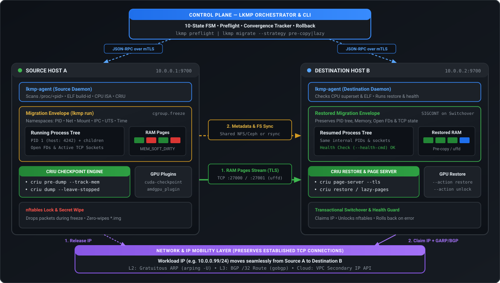
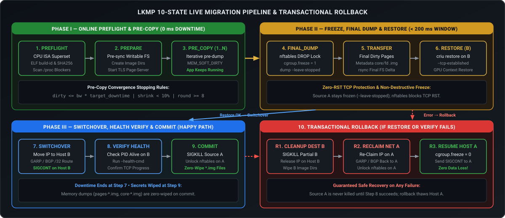

# LKMP (`lkmp`) — Linux Process Live Migration Orchestrator

<p align="center">
  <a href="https://github.com/xsub/LKMP/actions/workflows/ci.yml"></a>
  <a href="https://opensource.org/licenses/Apache-2.0"></a>
  <a href="https://www.python.org/downloads/"></a>
  <a href="https://criu.org/"></a>
  
</p>

**LKMP** (`lkmp`) is a process-tree live migration orchestrator built on top of **CRIU** (*Checkpoint/Restore In Userspace*). It moves a running Linux process (or process tree) from **Source Host A** to **Destination Host B** with minimal downtime, preserving virtual memory, registers, open file descriptors, and established TCP connections—while guaranteeing a deterministic **rollback** to the source host if anything fails.

<p align="center">
  
</p>

---

## Key State-of-the-Art (SOTA) Capabilities

- **Adaptive Strategy Auto-Pilot & VMA Locality Profiler (`--strategy auto`, `lkmp/pagemap.py`)**:
  - Profiles live memory write rates via kernel `/proc/<pid>/clear_refs` and binary 64-bit `/proc/<pid>/pagemap` (`PTE_SOFT_DIRTY`, bit 55).
  - Classifies each Virtual Memory Area (`[heap]`, `[stack]`, `mmap`) into `COLD` (`< 5%`), `WARM` (`5%..60%`), or `HOT_THRASHING` (`>= 60%` dirty density), estimates Shannon byte entropy (`H(X)` in `[0, 8]` bits/byte) for `zstd`/`lz4` compressibility, and automatically selects `cold`, `pre-copy`, or `hybrid` (`pre-dump` + `userfaultfd` `--lazy-pages`).
- **Asymptotic Hot-Floor & Knee-of-Curve Convergence Predictor (`lkmp/convergence.py`)**:
  - Models the dirty-page decay trajectory `D(t) = D_inf + A * r^t` across consecutive `pre-dump` rounds to predict the non-converging hot working-set floor (`D_inf`) in advance—cutting over at the knee of the curve instead of wasting network bandwidth re-copying thrashing pages.
- **Cryptographic Merkle-Tree Checkpoint Attestation (`lkmp/attestation.py`)**:
  - Signs every CRIU checkpoint directory (`manifest.sig.json`) on Source A using a binary SHA-256 Merkle tree and HMAC-SHA256 digest over all `.img` files.
  - Verifies integrity on Destination B **before** `criu restore` executes; even a single-byte bitflip in `core-*.img` is blocked prior to execution and triggers an automatic **Transactional Rollback** to Source A.
- **Zero-Drop eBPF / IPIP Hairpin Redirect & L2/L3 IP Mobility (`--ip-mobility ebpf|garp|bgp|cloud`, `lkmp/network.py`)**:
  - Locks workload network traffic with `nftables` (preventing kernel TCP `RST` packets during switchover), establishes an on-demand `ipip` / `tc` hairpin forwarder (`lkmp0`) from Source A to Destination B so in-flight packets arriving before upstream router convergence are never dropped, and announces the moved IP via L2 Gratuitous ARP (`garp`), L3 BGP `/32` routes (`bgp`), or cloud API webhooks (`cloud`).
- **Distributed Two-Phase Commit (2PC) Gang Migration (`lkmp/gang.py`)**:
  - Coordinates atomic multi-process / microservice / MPI-rank gang migrations across a global preflight barrier and a 2PC commit/rollback barrier—guaranteeing that either all coupled processes cut over to Destination B together or all roll back atomically to Source A without split-brain.
- **Migration Envelope (`lkmp run`, `lkmp/envelope.py`)**:
  - Launches workloads inside isolated `pid`, `net`, `mnt`, `ipc`, `uts`, and `time` (`CLOCK_MONOTONIC` / `CLOCK_BOOTTIME` offset) namespaces attached to a dedicated `cgroup v2` hierarchy for atomic freezing.
- **Non-Destructive Preflight Analysis (`lkmp preflight`, `lkmp/preflight.py`)**:
  - Verifies Destination B CPU instruction-set superset (`avx2`, `avx512f`, `xsave`, `sve`), parses ELF64/ELF32 `.note.gnu.build-id` notes, and detects kernel blockers (`io_uring`, active `TracerPid`, unconfigured GPUs).

---

## Live Migration Pipeline & Rollback Safety Net

<p align="center">
  
</p>

### End-to-End Sequence Diagram

```mermaid
sequenceDiagram
    autonumber
    participant CLI as 💻 lkmp Controller
    participant A as 🟢 Source Host A (lkmp-agent)
    participant B as 🔵 Dest Host B (lkmp-agent)
    participant NET as 🌐 Network Fabric (GARP/BGP)

    rect rgb(18, 45, 31)
    Note over CLI,B: PHASE 1–3: ONLINE PREFLIGHT & ITERATIVE PRE-COPY (0 ms Downtime — App Running on A)
    CLI->>A: get_capabilities() & inspect_process(pid) (/proc/pid/pagemap soft-dirty)
    CLI->>B: get_capabilities() & stat_files(paths)
    Note over CLI: Verify CPU ISA Superset, ELF build-id & auto-select strategy
    CLI->>A: pre_sync_fs() (initial rsync pass)
    loop Iterative Pre-Copy (Round 1..N until converged)
        CLI->>B: start_page_server(round=N, --tls)
        CLI->>A: run_pre_dump(round=N, --track-mem --page-server)
        A-->>B: Stream dirty RAM pages over TLS (:27000)
    end
    end

    rect rgb(60, 42, 15)
    Note over CLI,NET: PHASE 4–7: FREEZE, FINAL DUMP & SWITCHOVER (< 200 ms Target Downtime)
    CLI->>A: freeze_and_final_dump()
    Note over A: nftables DROP lock + cgroup.freeze + criu dump --leave-stopped
    A-->>B: Final dirty pages + metadata .img + rsync delta
    CLI->>B: restore_process(--tcp-established --leave-stopped)
    CLI->>A: release_ip(workload_ip)
    CLI->>B: claim_ip_and_resume(restored_pid)
    B->>NET: Broadcast Gratuitous ARP / BGP /32 route + SIGCONT
    end

    alt Verification Succeeds (Health Check OK on B)
        rect rgb(18, 38, 60)
        CLI->>B: verify_process(--health-cmd) -> HEALTHY
        CLI->>A: commit_source() (SIGKILL frozen source + zero-wipe *.img)
        CLI->>B: cleanup_dest() (zero-wipe *.img)
        end
    else Restore or Health Check Fails (Transactional Rollback)
        rect rgb(65, 22, 26)
        CLI->>B: rollback_dest() (SIGKILL partial process + release IP)
        CLI->>A: rollback_source() (Re-claim IP + unlock nftables + SIGCONT)
        Note over A: Original process resumes on Source A with zero data loss!
        end
    end
```



### State Machine Diagram


---

## Migration Strategies & Pre-Copy Convergence

| Strategy (`--strategy`) | Downtime | Risk | Best For |
| :--- | :--- | :--- | :--- |
| **`auto`** *(recommended)* | Dynamic | Low | Profiles `/proc/<pid>/pagemap` dirty rate and picks `cold`, `pre-copy`, or `hybrid` |
| **`cold`** | `RSS / bandwidth` (seconds) | Lowest | Small processes (`<= 8 MiB`), batch jobs, simple stop-and-copy |
| **`pre-copy`** | `final_dirty / bandwidth + restore` (tens to hundreds of ms) | Low (full rollback on A) | General stateful services, databases, network servers |
| **`lazy`** | Minimal (metadata transfer only) | Higher (page faults over network via `userfaultfd`) | Huge memory footprints with high write rates where pre-copy does not converge |
| **`hybrid`** | Minimal | Medium | Write-intensive workloads (`>= 70%` of link bandwidth): `pre-dump` rounds + `--lazy-pages` |

### Pre-Copy Convergence Rules

Iterative `pre-dump` rounds stop automatically when **any** of the following conditions is met:

| # | Condition | Formula / Threshold | Meaning |
| :--- | :--- | :--- | :--- |
| **1** | **Target Downtime Met** | `dirty_bytes <= effective_bw * target_downtime` | Remaining dirty pages fit inside `--target-downtime-ms` (default `200 ms`) |
| **2** | **Knee-of-Curve Floor (`D_inf`)** | `D_inf > threshold and dirty_bytes <= 1.20 * D_inf` | Asymptotic exponential predictor detects a non-converging hot working-set plateau |
| **3** | **Diminishing Returns** | `(prev_dirty - dirty_bytes) / prev_dirty < 10%` | Dirty page volume shrank by less than `10%` since the previous round |
| **4** | **Iteration Cap** | `iteration >= max_iter` | Reached maximum pre-copy rounds (`--max-iter`, default `8`) |

---

## Try It in 5 Seconds (`lkmp demo`)

`lkmp` includes a built-in two-node cluster simulator (`Source Host A` and `Destination Host B` communicating over real loopback TCP JSON-RPC sockets) so you can test pre-copy convergence, Prometheus telemetry, and transactional rollback on any machine:

```bash
git clone https://github.com/xsub/LKMP.git
cd LKMP

# 1. Run a live pre-copy migration demo with Prometheus metrics
./bin/lkmp demo --strategy auto --rss-mb 256 --dirty-mbps 40 --prometheus
```

```text
┌──────────────────────────────────────────────────────────────────────────┐
│ LKMP LIVE MIGRATION EXECUTION SUMMARY                                    │
├──────────────────────────────┬───────────────────────────────────────────┤
│ Migration ID                 │ mig-c698365a                              │
│ Strategy                     │ pre-copy                                  │
│ Outcome                      │ COMMITTED ON DESTINATION B                │
│ Final FSM State              │ COMMIT                                    │
│ Restored PID on Host B       │ 8484                                      │
│ Freeze Window Downtime       │ 1.85 ms                                   │
│ Total Migration Duration     │ 139.68 ms                                 │
└──────────────────────────────┴───────────────────────────────────────────┘

Iterative Pre-Copy Convergence (Online Phase — 0 ms Downtime):
  Round 1: [████████████████████████]  115.2 MiB in    0.1 ms  (STREAMED)
  Round 2: [█████░░░░░░░░░░░░░░░░░░░]   24.0 MiB in    0.1 ms  (STREAMED)
  Round 3: [██░░░░░░░░░░░░░░░░░░░░░░]   10.0 MiB in    0.1 ms  (CONVERGED)
           └─ Dirty set (10485760 B) is within target downtime budget (25000000 B)

FSM Trajectory:
  INIT -> PREFLIGHT -> PREPARE -> PRE_COPY -> PRE_COPY -> PRE_COPY -> FREEZE -> FINAL_DUMP -> TRANSFER -> RESTORE -> SWITCHOVER -> VERIFY -> COMMIT
```

```bash
# 2. Inject a post-switchover health check failure or 1-byte image tamper to see Transactional Rollback
./bin/lkmp demo --strategy pre-copy --inject-fault verify
./bin/lkmp demo --strategy cold --inject-fault corrupt-image

# 3. Run the full SOTA comparative benchmark suite across 4 workload profiles
./bin/lkmp benchmark
```

```text
┌──────────────────────────────┬──────────┬───────────┬──────────┬───────────┬────────────────────────────┐
│ Workload Scenario            │ RSS      │ WriteRate │ AutoMode │ FreezeWin │ Final Outcome              │
├──────────────────────────────┼──────────┼───────────┼──────────┼───────────┼────────────────────────────┤
│ 1. Edge Microservice         │ 6 MiB    │ 0 MiB/s   │ cold     │ 1.80 ms   │ COMMIT (PID 8484)          │
│ 2. Stateful Redis / DB       │ 512 MiB  │ 35 MiB/s  │ pre-copy │ 1.75 ms   │ COMMIT (PID 8484)          │
│ 3. Write-Heavy AI/Analytics  │ 1024 MiB │ 105 MiB/s │ hybrid   │ 1.90 ms   │ COMMIT (PID 8484)          │
│ 4. Tampered .img Attack      │ 256 MiB  │ 30 MiB/s  │ pre-copy │ 1.40 ms   │ ROLLBACK (Merkle Block)    │
└──────────────────────────────┴──────────┴───────────┴──────────┴───────────┴────────────────────────────┘
```

---

## Production Usage on Two Linux Hosts

### 1. Start `lkmp-agent` on Source A and Destination B

On both Linux hosts (requires `root` or `CAP_CHECKPOINT_RESTORE` + `CAP_SYS_ADMIN` + `CAP_NET_ADMIN`):

```bash
# On Source Host A (10.0.0.1)
sudo ./bin/lkmp agent \
  --host 0.0.0.0 \
  --port 9700 \
  --tls-ca /etc/lkmp/ca.pem \
  --tls-cert /etc/lkmp/node-a.pem \
  --tls-key /etc/lkmp/node-a.key

# On Destination Host B (10.0.0.2)
sudo ./bin/lkmp agent \
  --host 0.0.0.0 \
  --port 9700 \
  --tls-ca /etc/lkmp/ca.pem \
  --tls-cert /etc/lkmp/node-b.pem \
  --tls-key /etc/lkmp/node-b.key
```

### 2. Launch a Workload inside a Migration Envelope on Host A

```bash
sudo ./bin/lkmp run \
  --id srv-1 \
  --ip 10.0.0.99/24 \
  --iface eth0 \
  -- /usr/local/bin/my-stateful-server
```

### 3. Run Non-Destructive Preflight Check

```bash
./bin/lkmp preflight \
  --pid 4242 \
  --source 10.0.0.1:9700 \
  --dest 10.0.0.2:9700 \
  --strategy auto
```

### 4. Live-Migrate the Process Tree from Host A to Host B

```bash
./bin/lkmp migrate \
  --pid 4242 \
  --workload-id srv-1 \
  --source 10.0.0.1:9700 \
  --dest 10.0.0.2:9700 \
  --strategy auto \
  --fs-mode rsync \
  --writable-path /var/lib/my-stateful-server \
  --ip-mobility garp \
  --workload-ip 10.0.0.99/24 \
  --health-cmd "curl -sf http://10.0.0.99:8080/healthz"
```

---

## Project Structure

```text
.
├── .github/workflows/ci.yml      # GitHub Actions CI matrix (Python 3.10 - 3.13)
├── bin/lkmp                      # Executable CLI entrypoint
├── docs/assets/                  # High-resolution architecture & pipeline SVG diagrams
├── lkmp/
│   ├── config.py                 # MigrationConfig, EnvelopeConfig, strategy/mode enums
│   ├── models.py                 # State machine states, preflight & telemetry models
│   ├── envelope.py               # Namespace unshare & cgroup v2 freeze manager
│   ├── pagemap.py                # Kernel /proc/<pid>/pagemap profiler, VMA heat & Shannon entropy
│   ├── preflight.py              # /proc inspector, ELF build-id parser, ISA superset checker
│   ├── convergence.py            # Pre-copy convergence math & asymptotic floor (D_inf) predictor
│   ├── attestation.py            # SHA-256 Merkle-tree & HMAC checkpoint image attestation
│   ├── gang.py                   # Distributed Two-Phase Commit (2PC) gang migration coordinator
│   ├── criu_driver.py            # CRIU command builder & GPU plugin hooks (cuda-checkpoint, amdgpu)
│   ├── network.py                # nftables lock & eBPF/GARP/BGP/Cloud IP mobility
│   ├── fs_sync.py                # rsync pre-sync, frozen delta sync & zero-wipe
│   ├── telemetry.py              # Prometheus OpenMetrics collector & terminal TUI renderer
│   ├── demo.py                   # Two-node loopback TCP migration simulator & SOTA benchmark
│   ├── agent.py                  # Privileged host daemon (lkmp-agent) & TLS JSON-RPC
│   ├── orchestrator.py           # 10-state migration controller & rollback engine
│   └── cli.py                    # CLI parser and command handlers
├── deploy/
│   ├── Dockerfile.node           # Ubuntu 24.04 node image with CRIU, nftables, iproute2
│   └── docker-compose.test.yml   # Two-node privileged test cluster on shared L2 bridge
└── tests/                        # 27 unit, SOTA & end-to-end two-agent TCP RPC tests
```

---

## Two-Node Test Cluster (Docker Compose)

You can spin up a two-node Linux cluster (`node-a` at `172.28.0.10` and `node-b` at `172.28.0.11`) with CRIU, `nftables`, `iproute2`, and `rsync` pre-installed:

```bash
docker compose -f deploy/docker-compose.test.yml up -d --build
```

---

## CLI Reference

| Command | Description |
| :--- | :--- |
| `lkmp run` | Start a process tree inside an isolated PID/net/mnt/ipc/uts/time namespace and `cgroup v2` envelope |
| `lkmp agent` | Start the privileged `lkmp-agent` JSON-RPC daemon on a host |
| `lkmp preflight` | Inspect `/proc/<pid>`, profile `pagemap` dirty rate, verify CPU ISA superset & ELF build-ids on B |
| `lkmp migrate` | Run the full migration state machine (`Preflight` → `PreCopy` → `Freeze` → `Restore` → `Switchover` → `Verify` → `Commit`/`Rollback`) |
| `lkmp demo` | Spin up a two-node loopback TCP cluster and run a live migration benchmark with fault injection & Prometheus metrics |

---

## License

Licensed under the [Apache License 2.0](LICENSE).
